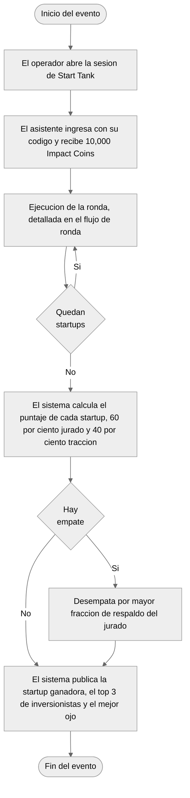
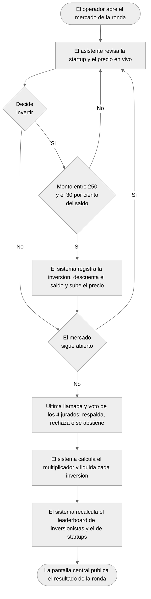
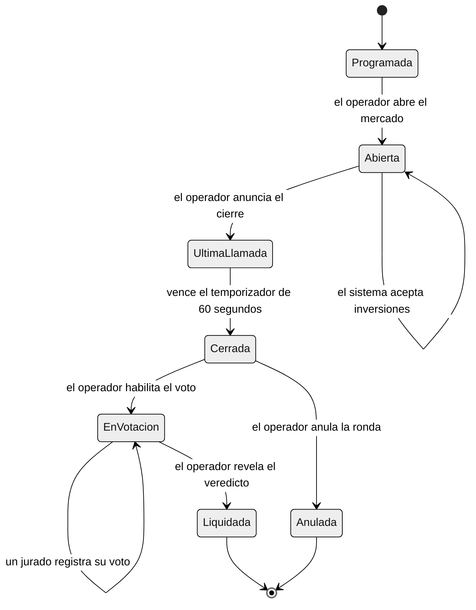
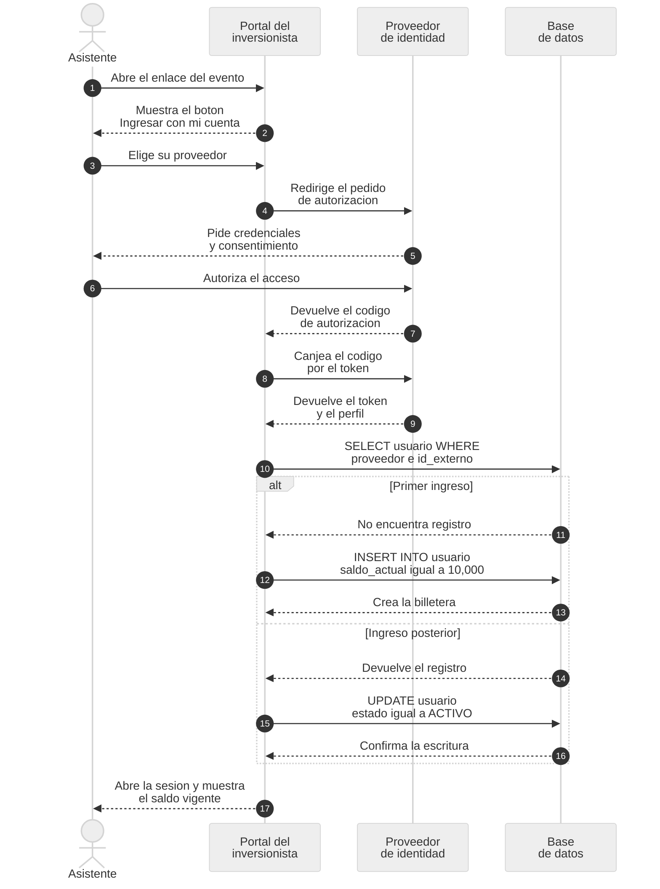
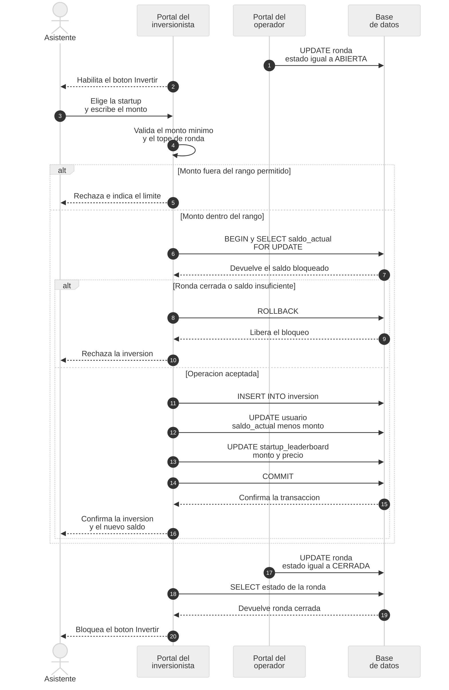
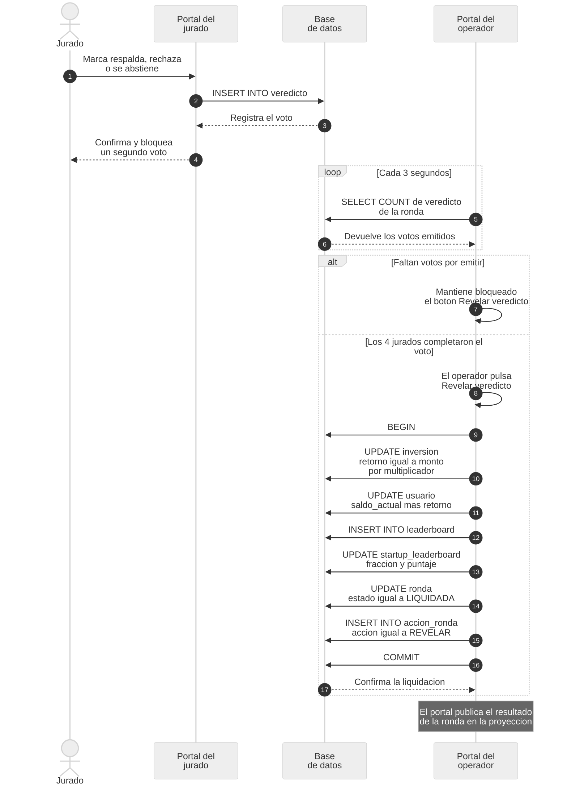
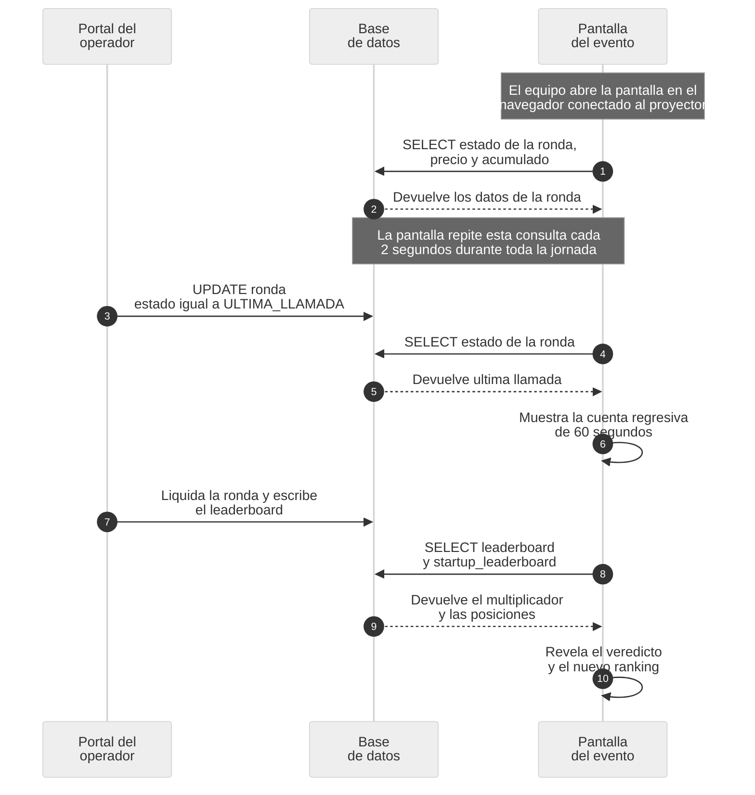
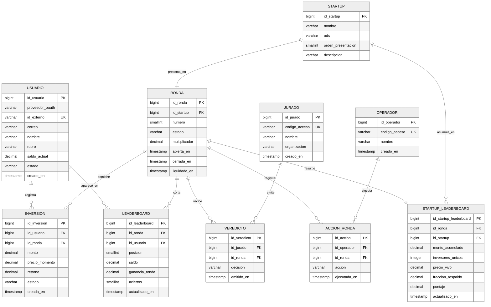
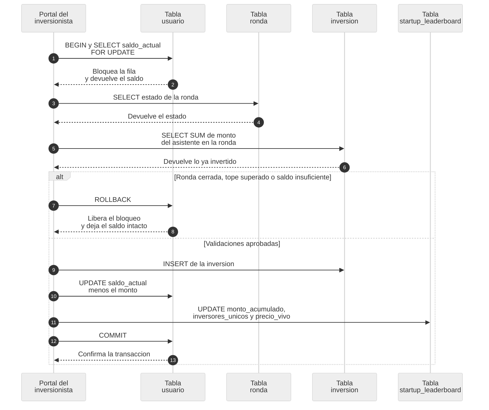
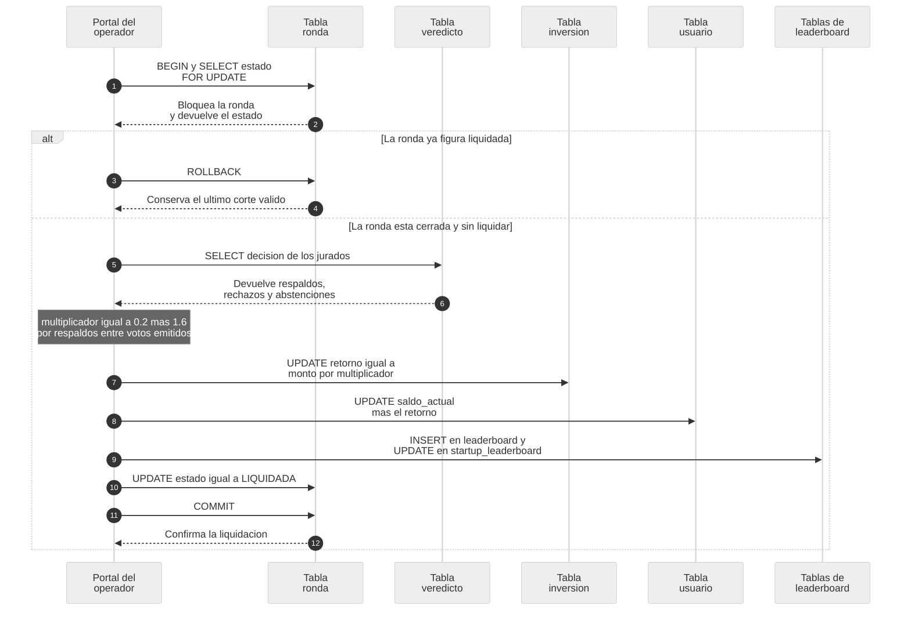

# Start Tank

**Sistema de inversión para el Shark Tank Universitario**

Documento de especificación funcional y técnica

Hult Prize at UNI · Universidad Nacional de Ingeniería
Edición Impacto ODS, noviembre de 2026

---

## 1. El evento

Start Tank es la plataforma de inversión del Shark Tank Universitario que Hult Prize at UNI realiza
el jueves 26 de noviembre de 2026 en el Auditorio CTIC de la Universidad Nacional de Ingeniería. El
evento presenta el concurso a la comunidad UNI y acerca a los estudiantes al emprendimiento mediante
una simulación de inversión.

Cinco startups presentan su propuesta ante un jurado de cuatro integrantes. Entre 50 y 80 asistentes
invierten un capital ficticio desde su teléfono mientras cada startup expone. El jurado emite su
veredicto al cerrar el mercado y ese veredicto determina cuánto gana o pierde cada asistente.

### 1.1 Estructura de la jornada

El evento se organiza en cinco rondas, una por startup. Cada ronda dura 13 minutos y sigue siempre la
misma secuencia: pitch de 4 minutos, preguntas del jurado durante 4 minutos, última llamada de 1
minuto, veredicto de 2.5 minutos y publicación del resultado.

### 1.2 Qué resuelve el sistema

- Entrega a cada asistente una billetera de 10,000 Impact Coins y registra sus inversiones.
- Publica en la pantalla proyectada en el auditorio el precio en vivo de cada startup y el interés
  que genera en la sala.
- Entrega al operador el control del ciclo de cada ronda: abrir, cerrar y revelar el veredicto.
- Recoge el voto de los cuatro jurados y calcula el multiplicador de la ronda.
- Liquida las inversiones, actualiza los saldos y recalcula los dos leaderboards.
- Determina la startup ganadora, el top 3 de inversionistas y el asistente con mejor ojo.

---

## 2. Reglas de negocio

Las reglas que siguen son las que el sistema implementa. El retorno de cada asistente depende solo
del veredicto del jurado. El precio en vivo funciona como indicador del interés de la sala y no
interviene en el cálculo del retorno.

### 2.1 Capital y límites de inversión

| Regla | Valor |
|---|---|
| Capital inicial por asistente | 10,000 Impact Coins |
| Compra mínima | 250 Impact Coins |
| Tope por ronda | 30 por ciento del saldo al abrir la ronda |
| Operaciones permitidas | Solo compra. El sistema no permite vender antes del veredicto. |
| Rondas | 5, una por startup |

El sistema bloquea la venta porque vender antes del cierre permitiría asegurar una ganancia sin
exponerse al veredicto. Con la regla de compra única, el asistente solo gana si elige una startup que
el jurado respalda.

### 2.2 Precio en vivo

Cada startup abre su ronda con un precio de 100. El sistema sube el precio según el monto acumulado
que la sala invierte, no según la cantidad de operaciones. Diez compras de 250 coins mueven el precio
igual que una sola compra de 2,500 coins. El precio se mantiene entre 50 y 200 y aparece en la
pantalla proyectada.

### 2.3 Portal del inversionista

El asistente ingresa mediante **OAuth** con la cuenta que prefiera y opera desde una aplicación web
que no requiere instalación. El sistema no pide ni almacena contraseñas: recibe del proveedor de
identidad el identificador externo y el correo, y con esos datos crea la billetera de 10,000 Impact
Coins en el primer ingreso.

La pantalla muestra la startup en escena, su precio en vivo, el saldo disponible, el portafolio de la
ronda y el botón Invertir. El sistema actualiza esos datos cada 3 segundos mientras la ronda
permanece abierta y bloquea el botón Invertir cuando el operador cierra el mercado.

Si el asistente pierde la conexión o cierra el navegador, vuelve a ingresar con la misma cuenta y el
sistema reanuda su sesión con el saldo vigente. Cada cuenta externa queda asociada a una sola
billetera durante todo el evento.

### 2.4 Portal del jurado

Los cuatro jurados ingresan con un código propio a un portal separado. Cada jurado marca una de tres
decisiones por ronda: respalda, rechaza o se abstiene. El jurado se abstiene cuando declara conflicto
de interés con la startup en escena.

El portal del jurado registra votos y nada más. No abre ni cierra el mercado, no revela el veredicto
y no liquida la ronda: esas acciones pertenecen al portal del operador. Esa separación evita que un
jurado interrumpa el evento con una pulsación equivocada.

El sistema publica los cuatro votos a la vez, nunca de forma parcial, para que ningún jurado quede
condicionado por el voto de otro.

Los jurados evalúan dos criterios con el mismo peso: la viabilidad del negocio y el impacto alineado
con los Objetivos de Desarrollo Sostenible. El equipo organizador anuncia ambos criterios en la
apertura del evento.

### 2.5 Portal del operador

El operador pertenece al equipo organizador y conduce el evento desde un portal propio. Ingresa con
un código de acceso y controla el ciclo de cada ronda con cinco acciones: abrir el mercado, declarar
la última llamada, cerrar el mercado, revelar el veredicto y pasar a la siguiente startup.

La acción **Revelar veredicto** dispara la liquidación de la ronda. El portal la mantiene bloqueada
hasta que los cuatro jurados emiten su voto, de modo que el operador no puede liquidar una ronda
incompleta.

El portal muestra al operador el estado de la ronda, los votos emitidos, el monto acumulado por
startup y la cantidad de asistentes conectados. Esa vista alimenta la pantalla proyectada en el
auditorio.

El sistema registra cada acción del operador en la tabla `accion_ronda`, con la hora y el
identificador de quien la ejecutó, de modo que el equipo puede reconstruir el orden del evento si
algo falla.

### 2.6 Pantalla del evento

La pantalla del evento es la vista que el equipo proyecta en el auditorio. El portal del inversionista
la sirve como una página pública de solo lectura: el equipo la abre en una pestaña del navegador de
la laptop conectada al proyector y la deja en pantalla completa durante toda la jornada.

La pantalla no pide autenticación, porque la ve toda la sala, y no ejecuta ninguna escritura. Consulta
la base de datos cada 2 segundos y refleja el estado que los otros tres portales ya produjeron, de
modo que no puede alterar una ronda ni el saldo de un asistente.

| Fase de la ronda | Qué muestra la pantalla |
|---|---|
| Mercado abierto | Nombre de la startup, su ODS, el precio en vivo, el monto acumulado y la cantidad de inversores únicos. |
| Última llamada | Cuenta regresiva de 60 segundos sobre el precio, con aviso de cierre inminente. |
| Votación | Aviso de que el jurado delibera y cuántos votos lleva emitidos, sin revelar el sentido de ninguno. |
| Liquidación | Los cuatro votos a la vez, el multiplicador resultante y el retorno que deja la ronda. |
| Entre rondas | Leaderboard de inversionistas y el acumulado de cada startup hasta ese momento. |
| Cierre del evento | Startup ganadora con su puntaje, top 3 de inversionistas y el asistente con mejor ojo. |

Si la laptop del proyector pierde la conexión, la pantalla deja de actualizarse y conserva el último
estado recibido. El equipo recarga la pestaña y recupera la vista sin afectar a los asistentes ni al
operador, porque la pantalla no guarda estado propio.

### 2.7 Multiplicador del veredicto

El sistema calcula el multiplicador de cada ronda con la fórmula **0.2 + 1.6 × fracción de
respaldo**, donde la fracción de respaldo es el número de jurados que respaldan dividido entre el
número de jurados que emitieron voto.

| Respaldos | Fracción | Multiplicador | Resultado para el asistente |
|---|---|---|---|
| 0 de 4 | 0.00 | 0.2x | Pierde el 80 por ciento de lo invertido |
| 1 de 4 | 0.25 | 0.6x | Pierde el 40 por ciento de lo invertido |
| 2 de 4 | 0.50 | 1.0x | Recupera lo invertido |
| 3 de 4 | 0.75 | 1.4x | Gana el 40 por ciento de lo invertido |
| 4 de 4 | 1.00 | 1.8x | Gana el 80 por ciento de lo invertido |

La fórmula entrega un multiplicador de 1.0x cuando el jurado queda dividido. Invertir sin criterio no
produce ganancia esperada, de modo que solo gana quien elige startups mejor evaluadas que el
promedio.

Cuando un jurado se abstiene, el sistema lo excluye del denominador. Si tres jurados votan y los tres
respaldan, la fracción es 1.00 y el multiplicador es 1.8x.

### 2.8 Liquidación

El sistema liquida cada inversión como **monto invertido × multiplicador de la ronda**. El precio de
compra y el precio de cierre no intervienen en ese cálculo. El efectivo regresa a la billetera del
asistente antes de que abra la ronda siguiente, así que nadie queda sin capital por haber invertido
en las primeras rondas.

Ejemplo: si un asistente invierte 2,000 coins en una startup que obtiene 3 de 4 respaldos, el sistema
le acredita 2,800 coins. Si esa misma startup obtiene 1 de 4 respaldos, le acredita 1,200 coins.

### 2.9 Startup ganadora y desempate

Al liquidar la quinta ronda, el sistema calcula el puntaje de cada startup como **60 por ciento de la
fracción de respaldo más 40 por ciento del porcentaje de asistentes que invirtieron en ella**. Gana
la startup con el puntaje más alto.

La fórmula combina la evaluación experta del jurado con la tracción que la startup logra en la sala.
Cuando dos startups empatan, el sistema declara ganadora a la que obtuvo la mayor fracción de
respaldo del jurado.

### 2.10 Clasificación de los inversionistas

El sistema publica dos clasificaciones al cerrar la última ronda. La primera ordena a los asistentes
por su saldo final y destaca los tres más altos. La segunda identifica al asistente con mejor ojo: el
que acertó en más rondas, contando como acierto cada inversión en una startup que obtuvo 3 o 4
respaldos.

La segunda clasificación mide el criterio de inversión y no el tamaño de la apuesta, de modo que un
asistente prudente compite en igualdad con quien arriesgó el tope en todas las rondas.

---

## 3. Actores y módulos del sistema

El sistema separa tres aplicaciones web y una vista pública que comparten una sola base de datos.
Cada una atiende a un rol distinto y ninguna puede ejecutar las acciones de las otras.

La separación cumple tres propósitos. Aísla el control del evento, que solo el operador ejerce.
Permite procesar los veredictos por ronda y publicarlos como un solo evento. Y evita que las
consultas constantes de los asistentes interfieran con el registro de los votos.

| Actor | Tipo | Responsabilidad |
|---|---|---|
| Asistente, jurado u operador | Persona | El asistente invierte desde su teléfono. El jurado emite su voto por ronda. El operador conduce el evento. Cada persona accede a un solo portal según su rol. |
| Portal del inversionista | Servidor de aplicación | Autentica al asistente mediante OAuth, valida los límites de inversión, registra las operaciones y entrega el precio en vivo, el saldo y el leaderboard. |
| Portal del jurado | Servidor de aplicación | Autentica al jurado y registra un voto por jurado y ronda. No controla el ciclo de la ronda ni ejecuta la liquidación. |
| Portal del operador | Servidor de aplicación | Autentica al operador, abre y cierra el mercado, revela el veredicto, ejecuta la liquidación y registra cada acción en `accion_ronda`. |
| Pantalla del evento | Vista pública de solo lectura | Proyecta el precio en vivo, el estado de la ronda y los leaderboards. El portal del inversionista la sirve sin autenticación y la pantalla no ejecuta escrituras. |
| Base de datos | Almacenamiento relacional | Guarda el estado completo del evento y garantiza la atomicidad de la inversión y de la liquidación mediante transacciones. |

El proveedor de identidad que autentica al asistente es un sistema externo. Interviene solo en el
ingreso, no almacena información del evento y queda fuera del alcance de Start Tank.

---

## 4. Diagrama de flujo TO-BE

El flujo del sistema se presenta en dos niveles. El primero recorre el evento completo y el segundo
detalla lo que ocurre dentro de una ronda.

### 4.1 Flujo general del evento

*Figura 1. Flujo TO-BE general del evento.*

### 4.2 Flujo de una ronda

*Figura 2. Flujo TO-BE de una ronda.*

### 4.3 Estados de la ronda

La ronda es el intervalo que delimita la actualización de los leaderboards. El sistema controla su
avance con una máquina de estados y rechaza cualquier operación que no corresponda al estado vigente.

*Figura 3. Estados de la ronda.*

---

## 5. Diagramas de secuencia

Los cuatro diagramas siguientes recorren los momentos en que los actores interactúan: el ingreso del
asistente, la inversión durante la ronda y el veredicto con su liquidación. Cada diagrama muestra
solo los participantes que intervienen en ese momento, de modo que el portal que no cumple ningún
papel queda fuera. El cuarto recorre la pantalla proyectada en el auditorio.

### 5.1 Ingreso del asistente mediante OAuth

*Figura 4. Ingreso del asistente mediante OAuth y creación de su billetera.*

### 5.2 Inversión durante la ronda

*Figura 5. Registro de una inversión.*

### 5.3 Veredicto y liquidación

*Figura 6. Voto del jurado y liquidación ejecutada por el operador.*

### 5.4 Actualización de la pantalla del evento

*Figura 7. Actualización de la pantalla proyectada en el auditorio.*

---

## 6. Modelo de datos

La base de datos relacional reúne diez entidades. Las siete primeras sostienen la operación del
evento, la octava audita el control de las rondas y las dos últimas guardan el resultado ya calculado
de cada ronda.

| Entidad | Contenido | Filas esperadas |
|---|---|---|
| `usuario` | Asistente con su cuenta externa de OAuth, su rubro y su saldo vigente | 50 a 80 |
| `jurado` | Los cuatro jurados con su código de acceso | 4 |
| `operador` | El operador del evento con su código de acceso | 1 o 2 |
| `startup` | Las cinco startups con su ODS y su orden de presentación | 5 |
| `ronda` | Una por startup, con su estado y el multiplicador resultante | 5 |
| `inversion` | Libro mayor de las operaciones, con monto y retorno | Hasta 400 |
| `veredicto` | Un voto por jurado y ronda | 20 |
| `accion_ronda` | Registro de cada acción de control ejecutada por el operador | 25 a 30 |
| `leaderboard` | Posición y saldo de cada asistente al cierre de cada ronda | Hasta 400 |
| `startup_leaderboard` | Acumulado, precio y puntaje de cada startup por ronda | 5 |

La pantalla del evento no agrega entidades: solo lee `ronda`, `startup_leaderboard` y `leaderboard`,
las mismas tablas que consultan los teléfonos de los asistentes.

La entidad `ronda` es la que permite modelar el tiempo. Cada inversión, cada veredicto y cada corte de
leaderboard apunta a una ronda, de modo que el sistema reconstruye el estado del evento en cualquier
momento sin recurrir a tablas temporales.

### 6.1 Diagrama entidad-relación

*Figura 8. Diagrama entidad-relación de Start Tank.*

---

## 7. Funcionamiento de los leaderboards

### 7.1 Estrategia de actualización

El sistema combina dos modos de actualización. El precio en vivo y el acumulado por startup se
escriben **en línea**, dentro de la misma transacción que registra la inversión. Los dos leaderboards
se recalculan **por lotes**, una sola vez por ronda, durante la liquidación.

Ninguna pantalla agrega datos en el momento de leerlos. Los teléfonos consultan tablas que ya
contienen el resultado calculado, de modo que una lectura cuesta lo mismo con 10 asistentes que con
80.

| Dato | Modo de actualización | Momento de la escritura |
|---|---|---|
| `precio_vivo` y `monto_acumulado` | En línea, incremental | En cada inversión aceptada |
| `saldo_actual` del asistente | En línea | En la inversión y en la liquidación |
| Leaderboard de inversionistas | Lote por ronda | En la liquidación de la ronda |
| Puntaje de `startup_leaderboard` | Lote por ronda | En la liquidación de la ronda |
| Startup ganadora y clasificaciones | Lote único | Al liquidar la quinta ronda |

### 7.2 Por qué el sistema no usa tablas temporales

La tabla `inversion` funciona como libro mayor: el sistema inserta filas y no las borra. El único
campo que cambia después de la inserción es el retorno, que la liquidación escribe una sola vez por
ronda. Las tablas `leaderboard` y `startup_leaderboard` guardan una fila por ronda, así que el
historial queda completo y cualquier posición se puede reconstruir a partir de `inversion` y
`veredicto`.

Una tabla temporal perdería ese historial y obligaría a recalcular el evento completo ante una caída
del servicio. Con el diseño actual, el sistema conserva siempre el último corte liquidado.

### 7.3 Updates y rollbacks

- Cada inversión actualiza dos filas: la del asistente en `usuario` y la de la startup en
  `startup_leaderboard`.
- Cada liquidación actualiza las inversiones de una ronda, los saldos de los asistentes, una fila de
  `startup_leaderboard` y deja una fila en `accion_ronda`.
- El sistema ejecuta `ROLLBACK` solo cuando falla una validación: ronda cerrada, tope de ronda
  superado o saldo insuficiente. En ese caso ninguna fila cambia.
- La liquidación es idempotente. Si la ronda ya figura como liquidada, la transacción termina en
  `ROLLBACK` y conserva el resultado anterior.
- El bloqueo `SELECT ... FOR UPDATE` sobre la fila del asistente evita el doble gasto cuando una
  persona pulsa Invertir dos veces seguidas.

### 7.4 Volumen esperado

| Métrica | Valor |
|---|---|
| Asistentes simultáneos | 50 a 80 |
| Rondas del evento | 5 |
| Inversiones máximas en todo el evento | 400 |
| Lecturas por segundo | 27, con 80 teléfonos consultando cada 3 segundos |
| Escrituras por segundo en el pico | 10, en el último minuto de cada ronda |
| Filas escritas al liquidar una ronda | 80 retornos, 80 saldos y 80 filas de leaderboard |

Con ese volumen, una sola instancia de base de datos relacional atiende el evento completo. El
sistema no requiere particionado, réplicas de lectura ni caché externa.

### 7.5 Diagramas transaccionales

Las dos figuras siguientes recorren las transacciones del sistema y muestran las tablas que
intervienen en cada una. La transacción de inversión agrupa la validación, el registro y la
actualización del acumulado; el bloqueo sobre la fila del asistente garantiza que dos pulsaciones
simultáneas no gasten el mismo saldo. La transacción de liquidación escribe el retorno de cada
inversión, acredita los saldos, genera el corte de ambos leaderboards y cierra la ronda, todo en una
sola unidad atómica, de modo que la ronda nunca queda liquidada a medias.

*Figura 9. Transacción de registro de una inversión, con las tablas que intervienen.*

*Figura 10. Transacción de liquidación de la ronda, con las tablas que intervienen.*

---

## 8. Requerimientos funcionales

| RF | Descripción | Ejemplo |
|---|---|---|
| RF01 | El sistema debe autenticar al asistente mediante OAuth con el proveedor que elija y crear su billetera con 10,000 Impact Coins en el primer ingreso. | Si Juanita elige su cuenta de correo y autoriza el acceso, el sistema crea su billetera y muestra un saldo de 10,000 Impact Coins. |
| RF02 | El sistema debe asociar una sola billetera a cada cuenta externa y reanudar la sesión con el saldo vigente en los ingresos posteriores. | Si Juanita cierra el navegador durante la ronda 3 y vuelve a ingresar con la misma cuenta, el sistema reanuda su sesión con 13,200 coins y no crea una billetera nueva. |
| RF03 | El sistema debe habilitar las inversiones de una ronda solo cuando el operador la abre desde el portal del operador. | Si la ronda 2 figura como programada y el operador pulsa Abrir mercado, el sistema cambia el estado a abierta y activa el botón Invertir en los teléfonos. |
| RF04 | El sistema debe rechazar las inversiones menores a 250 Impact Coins. | Si Juanita escribe 200 coins, el sistema rechaza la operación y muestra que el monto mínimo es 250. |
| RF05 | El sistema debe limitar la inversión acumulada de cada asistente al 30 por ciento de su saldo al abrir la ronda. | Si Juanita abre la ronda 3 con 12,400 coins, el sistema le acepta hasta 3,720 coins en esa ronda y rechaza cualquier monto que supere ese tope. |
| RF06 | El sistema debe registrar cada inversión con el asistente, la ronda, el monto, el precio del momento y la hora. | Si Juanita invierte 2,000 coins en la ronda 3 con el precio en 118, el sistema crea una fila en inversion con esos cinco datos. |
| RF07 | El sistema debe descontar el monto invertido del saldo del asistente en la misma transacción que registra la inversión. | Si Juanita tiene 12,400 coins e invierte 2,000, el sistema deja su saldo disponible en 10,400 sin estados intermedios visibles. |
| RF08 | El sistema no debe permitir retirar una inversión registrada antes del veredicto de la ronda. | Si Juanita invierte 2,000 coins y luego intenta deshacer la operación, el sistema conserva la inversión hasta la liquidación. |
| RF09 | El sistema debe actualizar el precio de la startup en función del monto acumulado invertido en la ronda. | Si la startup abre en 100 y la sala acumula 20,000 coins, el sistema publica el precio en 110 en la pantalla proyectada en el auditorio. |
| RF10 | El sistema debe rechazar toda inversión que llegue después del cierre del mercado. | Si el operador cierra la ronda 3 a las 15:08 y una solicitud llega a las 15:09, el sistema la rechaza y deja el saldo intacto. |
| RF11 | El sistema debe impedir que un jurado o un asistente ejecute acciones de control de la ronda. | Si un jurado intenta cerrar el mercado desde su portal, el sistema rechaza la petición y deja la ronda abierta. |
| RF12 | El sistema debe registrar cada acción de control con el operador que la ejecutó y la hora. | Si el operador cierra la ronda 3 a las 15:08, el sistema crea una fila en accion_ronda con su identificador, la acción y esa hora. |
| RF13 | El sistema debe mantener bloqueada la acción Revelar veredicto hasta que los cuatro jurados emitan su voto. | Si en la ronda 3 solo votaron tres jurados, el sistema mantiene el botón bloqueado y muestra que falta un voto. |
| RF14 | El sistema debe publicar en la pantalla del evento el estado de la ronda, el precio en vivo y los leaderboards, sin pedir autenticación. | Si el equipo abre la pantalla en el navegador del proyector, el sistema muestra la ronda en curso y actualiza el precio cada 2 segundos sin solicitar credenciales. |
| RF15 | El sistema debe impedir que la pantalla del evento ejecute operaciones de escritura. | Si una petición de escritura llega desde la pantalla del evento, el sistema la rechaza y conserva el estado de la ronda. |
| RF16 | El sistema debe registrar el voto de cada jurado como respalda, rechaza o se abstiene. | Si el jurado Ramírez marca respalda en la ronda 3, el sistema crea una fila en veredicto con esa decisión y la hora de emisión. |
| RF17 | El sistema debe aceptar un solo voto por jurado y ronda. | Si el jurado Ramírez ya votó en la ronda 3 e intenta votar otra vez, el sistema rechaza el segundo voto y conserva el primero. |
| RF18 | El sistema debe calcular el multiplicador de la ronda como 0.2 más 1.6 por la fracción de jurados que respaldan. | Si 3 de los 4 jurados respaldan la startup, el sistema calcula 0.2 más 1.6 por 0.75 y obtiene un multiplicador de 1.4. |
| RF19 | El sistema debe excluir a los jurados que se abstienen del total de votos con que calcula la fracción de respaldo. | Si un jurado se abstiene y los otros tres respaldan, el sistema calcula la fracción como 3 entre 3 y obtiene un multiplicador de 1.8. |
| RF20 | El sistema debe liquidar cada inversión como el monto invertido por el multiplicador de la ronda y acreditar el resultado al saldo. | Si Juanita invirtió 2,000 coins y el multiplicador es 1.4, el sistema le acredita 2,800 coins y registra una ganancia de 800 en esa ronda. |
| RF21 | El sistema debe calcular el retorno sin usar el precio de compra ni el precio de cierre. | Si Juanita y Carlos invierten 2,000 coins cada uno en la misma startup con precios de 100 y 150, el sistema acredita el mismo retorno a ambos. |
| RF22 | El sistema debe recalcular la posición, el saldo y la ganancia de cada asistente al liquidar cada ronda. | Si al cerrar la ronda 3 Juanita acumula 13,200 coins, el sistema le asigna su posición y registra los 800 coins que ganó en la ronda. |
| RF23 | El sistema debe mantener por startup el monto acumulado y la cantidad de inversores únicos de su ronda. | Si 60 asistentes invierten 95,000 coins en la startup 2, el sistema guarda ambos valores en startup_leaderboard. |
| RF24 | El sistema debe calcular el puntaje de cada startup como 60 por ciento de la fracción de respaldo más 40 por ciento del porcentaje de asistentes que invirtieron en ella. | Si una startup obtiene 3 de 4 respaldos y 60 de 90 asistentes invierten en ella, el sistema calcula un puntaje de 0.72. |
| RF25 | El sistema debe declarar ganadora a la startup con el mayor puntaje una vez liquidada la última ronda. | Si la startup A obtiene 0.72 y la startup B obtiene 0.69, el sistema declara ganadora a la startup A. |
| RF26 | El sistema debe resolver el empate de puntaje a favor de la startup con la mayor fracción de respaldo del jurado. | Si dos startups empatan en 0.70 y una obtiene 3 de 3 respaldos frente a 3 de 4 de la otra, el sistema declara ganadora a la primera. |
| RF27 | El sistema debe contar las rondas en que cada asistente invirtió en startups con 3 o 4 respaldos y destacar al de mayor conteo. | Si Juanita acierta en 4 de las 5 rondas y ningún asistente supera ese conteo, el sistema la publica como la asistente con mejor ojo. |
| RF28 | El sistema debe publicar los tres saldos finales más altos al liquidar la última ronda. | Si los saldos más altos son 18,400, 17,900 y 16,200 coins, el sistema publica esos tres nombres en la pantalla proyectada en el auditorio. |
| RF29 | El sistema debe permitir al operador congelar el resultado en la última ronda liquidada. | Si el servicio falla durante la ronda 4, el operador congela el corte y el sistema publica el resultado de la ronda 3 como resultado vigente. |
| RF30 | El sistema debe exportar los saldos y las posiciones en cada liquidación. | Si el sistema liquida la ronda 3, genera un archivo con los saldos y las posiciones de los asistentes en ese momento. |

---

## 9. Requerimientos no funcionales

Las características corresponden al modelo de calidad de producto de la norma ISO/IEC 25010 en su
edición de 2023, que define nueve características.

| RNF | Descripción | Ejemplo | Característica |
|---|---|---|---|
| RNF01 | El sistema debe calcular multiplicadores, liquidaciones y puntajes sin desviación respecto de las fórmulas definidas. | Al cerrar un evento de 400 inversiones, la diferencia entre la suma de saldos y la suma de liquidaciones se mantiene en 0 coins. | Adecuación funcional |
| RNF02 | El sistema debe responder las consultas de estado en menos de 1 segundo con 80 sesiones concurrentes. | Con 80 teléfonos consultando cada 3 segundos, es decir 27 solicitudes por segundo, el percentil 95 del tiempo de respuesta se mantiene por debajo de 1,000 milisegundos. | Eficiencia de desempeño |
| RNF03 | El sistema debe operar en los navegadores móviles de uso común sin requerir instalación. | En Chrome 120 sobre Android y en Safari 16 sobre iOS, el portal ejecuta el 100 por ciento de sus funciones sin descargar ninguna aplicación. | Compatibilidad |
| RNF04 | El sistema debe permitir completar una inversión en tres toques como máximo. | Desde la pantalla principal, un asistente registra una inversión en 3 toques y en menos de 20 segundos de tarea. | Capacidad de interacción |
| RNF05 | El sistema debe mantener disponible el portal durante las tres horas del evento. | Entre las 14:00 y las 17:00, la disponibilidad se mantiene por encima del 99 por ciento, lo que admite un máximo de 108 segundos de interrupción acumulada. | Fiabilidad |
| RNF06 | El sistema debe impedir que un asistente registre operaciones a nombre de otro y no debe almacenar contraseñas. | Si una solicitud llega con un identificador de usuario distinto al de la sesión, el sistema la rechaza. Los umbrales admitidos son 0 operaciones aceptadas fuera de sesión y 0 contraseñas almacenadas. | Seguridad de la información |
| RNF07 | El sistema debe permitir modificar la fórmula del multiplicador y los límites de inversión desde la configuración. | Cambiar la base del multiplicador de 0.2 a 0.25 toma menos de 10 minutos y no exige modificar el código de las pantallas. | Mantenibilidad |
| RNF08 | El sistema debe operar con entre 3 y 6 jurados y entre 3 y 6 rondas sin cambios en el código. | Si el evento se ejecuta con 3 jurados y 4 startups, el sistema calcula el multiplicador sobre esa configuración sin un nuevo despliegue. | Flexibilidad |
| RNF09 | El sistema debe conservar el último corte liquidado ante una interrupción y permitir cerrar el evento en modo manual. | Si el servicio se interrumpe por más de 90 segundos durante la ronda 4, el sistema conserva el resultado de la ronda 3. El umbral es 0 rondas liquidadas perdidas. | Seguridad operativa |
