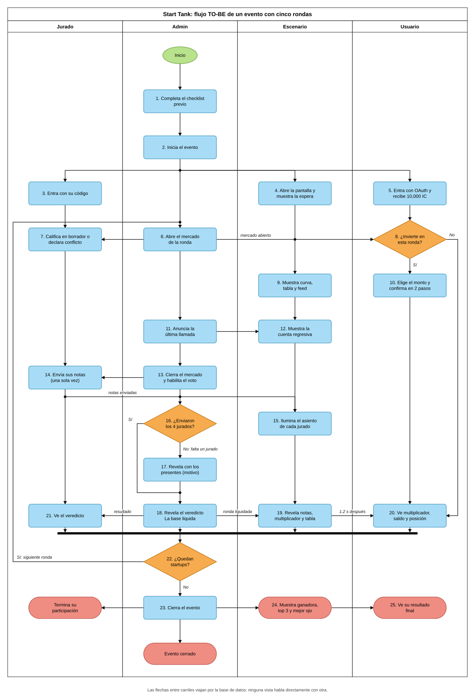
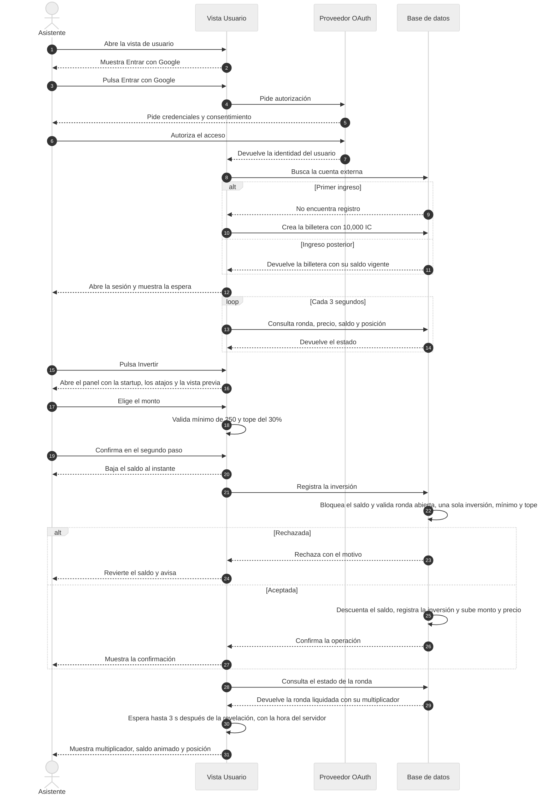
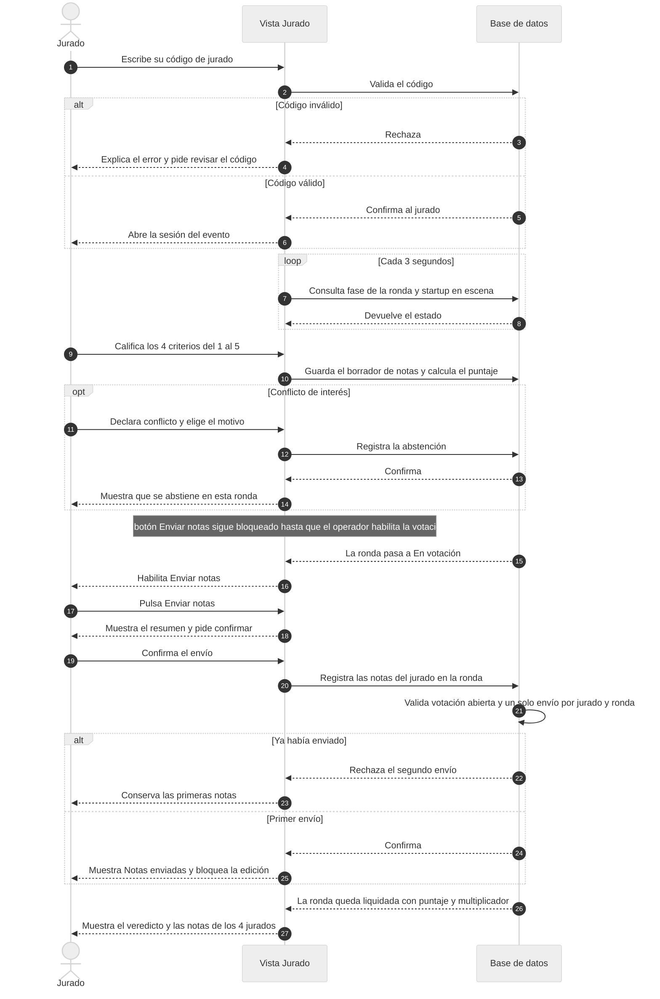
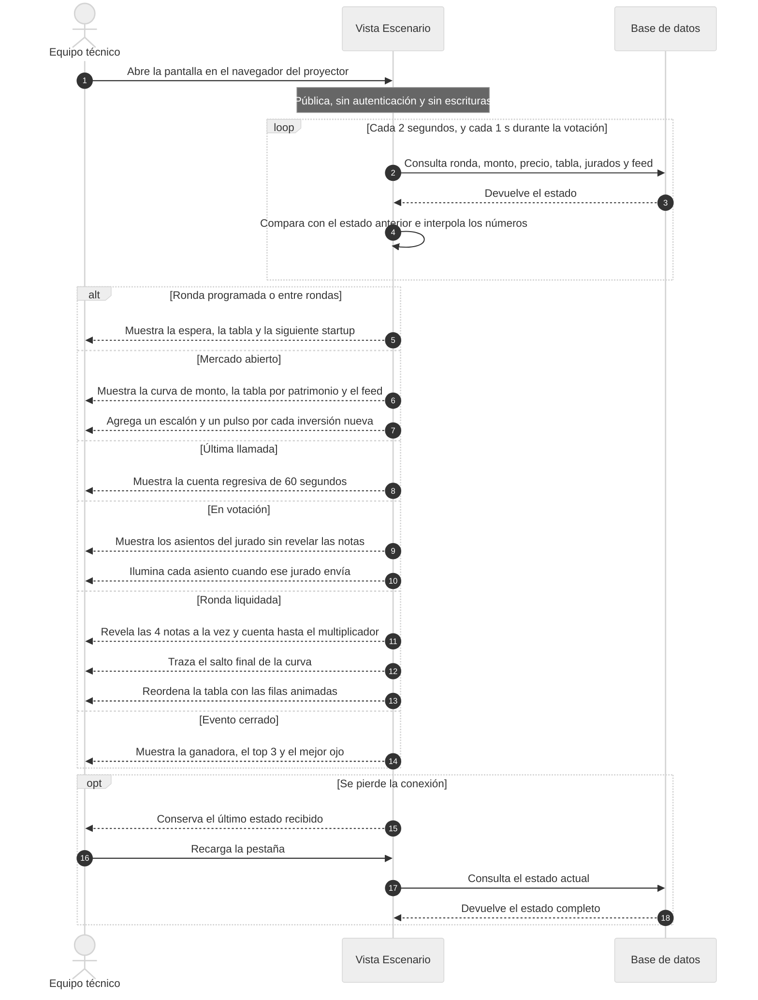
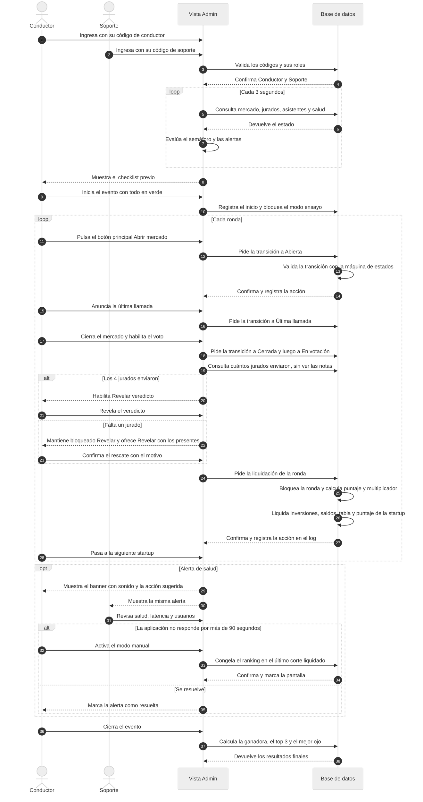
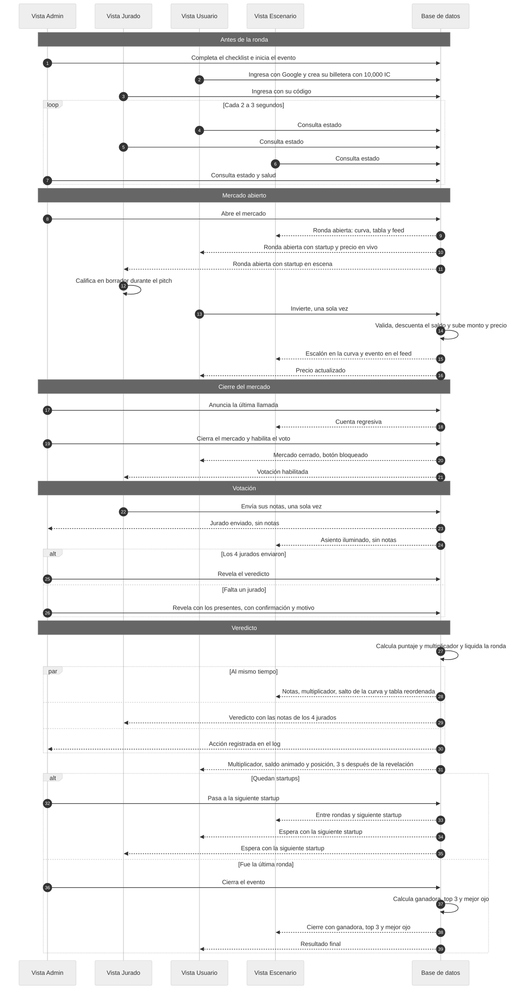

# Start Tank: arquitectura del sistema

Este documento describe el sistema Start Tank en su estado objetivo (TO-BE): qué se construye, cómo fluye el evento entre las vistas y cómo interactúan sus componentes. Parte de las decisiones de [BASES.md](BASES.md) y del bosquejo en Figma.

---

## 1. Descripción del proyecto y fuentes de información

### 1.1 Qué se desarrolla

Start Tank es la plataforma web del Shark Tank universitario de Hult Prize at UNI. Se usa el jueves 26 de noviembre de 2026, de 2:00 p. m. a 5:00 p. m., en el Auditorio CTIC de la Universidad Nacional de Ingeniería.

Cinco startups presentan su propuesta, una por ronda, ante un jurado de cuatro personas. Entre 80 y 100 asistentes invierten un capital ficticio (Impact Coins) desde su teléfono mientras cada startup expone. El jurado califica a la startup, esa calificación define un multiplicador y el multiplicador mueve el saldo de cada inversionista.

El objetivo del evento es dar a conocer Hult Prize at UNI y acercar a los estudiantes al emprendimiento. 

### 1.2 Las vistas

El sistema tiene cuatro vistas operativas y una portada. Todas leen y escriben en una sola base de datos, que es el único punto de encuentro entre ellas.

| Vista | Quién la usa | Dispositivo | Qué hace |
|---|---|---|---|
| **Landing** | Público | Teléfono o laptop | Presenta el evento, las reglas y el programa. Enlaza a los demás portales. No tiene lógica de negocio. |
| **Usuario** | Asistentes | Teléfono (también escritorio) | Entra con Google, invierte una vez por ronda y sigue su saldo, el precio en vivo y su posición. |
| **Jurado** | 4 jurados | Laptop o teléfono | Califica la startup en escena en 4 criterios del 1 al 5, o se abstiene por conflicto de interés. |
| **Escenario** | Auditorio | Proyector, solo lectura | Muestra en vivo la curva de inversión, la tabla de inversores, el veredicto y los resultados. |
| **Admin** | Conductor y soporte | Laptop | El conductor controla las rondas y los ajustes. El soporte vigila la salud del sistema, las alertas y los usuarios. |

### 1.3 Reglas del juego que sostienen la arquitectura

- Cada asistente recibe 10,000 Impact Coins (IC). La inversión mínima es de 250 IC y el máximo por ronda es el 30% del saldo.
- Cada asistente invierte **una sola vez** por ronda y no puede retirar la inversión antes del veredicto.
- Cada jurado califica 4 criterios con el mismo peso (25% cada uno): problema y mercado, modelo de negocio, impacto ODS, y equipo y pitch. La nota de cada criterio es un entero del 1 al 5.
- Puntaje de la startup = promedio de los puntajes de los jurados que votaron. Una abstención se excluye del promedio.
- **Multiplicador = 0.2 + 1.6 × ((puntaje − 1) / 4)**. Un puntaje de 3 da 1.0x, que es el punto neutro.
- Retorno de cada inversión = monto × multiplicador.
- Startup ganadora = 60% puntaje del jurado (convertido a porcentaje) + 40% porcentaje de asistentes que invirtieron en ella.
- El multiplicador se calcula en un solo lugar: la función de base de datos que revela el veredicto.
- Estados de una ronda: Programada, Abierta, Última llamada, Cerrada, En votación, Liquidada o Anulada.

### 1.4 Cambios respecto al spec original

El spec del 3 de noviembre (`Start Tank - Sistema de inversion.md`) quedó superado en estos puntos por las decisiones de BASES.md:

| Tema | Spec original | Sistema objetivo |
|---|---|---|
| Voto del jurado | Respalda, rechaza o se abstiene | Notas del 1 al 5 en 4 criterios, o abstención |
| Multiplicador | Según la fracción de jurados que respaldan | Continuo, según el puntaje promedio |
| Inversiones por ronda | Varias compras hasta el tope | Una sola inversión por ronda |
| Tabla de inversores | Por saldo, recalculada al liquidar | Por patrimonio (disponible + invertido), reordenada al liquidar |
| Admin | Un operador con 5 acciones | Dos roles, alertas, configuración, checklist y modo ensayo |
| Escenario | Fases de la ronda | Curva, tabla, cinta de startups, asientos del jurado y feed de eventos |

### 1.5 Fuentes de información

| Fuente | Qué aporta |
|---|---|
| `docs/start-tank-tech/BASES.md` | Fuente principal: las decisiones de producto de las cinco vistas y su conexión. |
| Archivo de Figma "Untitled" (`figma.com/design/HxJAp0mfO8C7WdZmMth0wt`) | Bosquejo de 44 pantallas, componentes, prototipo y especificación de movimiento. |
| `docs/events/start-tank/Start Tank - Sistema de inversion.md` | Spec funcional y técnico original: modelo de datos, máquina de estados, transacciones y requerimientos. Se usa donde BASES.md no lo contradice. |
| `docs/events/start-tank/Start Tank.pdf` | Plan formal del evento: horario, logística, equipo organizador, dinámica express y premios. Sus reglas de mecánica están desactualizadas. |
| `docs/HULT PRIZE AT UNI 2027 - Brochure.pdf` y `MANUAL DE MARCA - HULT PRIZE AT UNI.pdf` | Contexto del concurso, identidad de marca, paleta y tipografías. |
| Repositorio `start-tank-app` (rama `main`) | Implementación existente: Next.js 15, Neon Postgres, funciones SQL y portales. Se alineó al spec del 3 de noviembre. |

Pendiente de incorporar: `Impact_Coins_reglas_corregidas.docx`. No se ha revisado para este documento. Si contradice algo de lo anterior, se actualizan BASES.md y este documento.

Alcance: la landing solo enlaza a los otros portales, por eso no tiene diagrama de secuencia propio. Los diagramas de la sección 3 cubren los cuatro módulos operativos.

---

## 2. Diagrama TO-BE del sistema completo

El diagrama de actividades con carriles muestra el evento completo de principio a fin, con un carril por vista operativa: Jurado, Admin, Escenario y Usuario. La landing queda fuera porque solo enlaza a los portales y no tiene lógica de negocio.

Se lee de arriba hacia abajo. Las flechas que cruzan carriles son datos o acciones que viajan por la base de datos: ninguna vista habla directamente con otra. Los puntos negros indican que una línea alimenta a otra. La barra negra es una unión: el flujo sigue cuando las cuatro vistas terminaron de mostrar el resultado de la ronda.

| Símbolo | Significado |
|---|---|
| Óvalo verde | Inicio del evento |
| Rectángulo celeste | Actividad de una vista |
| Rombo naranja | Decisión |
| Barra negra | Unión: espera a que todas las vistas terminen |
| Terminal rojo | Fin del flujo de esa vista |

Los números de cada paso corresponden a la explicación que sigue al diagrama.

### 2.1 Explicación del flujo paso a paso

**Antes del evento**

1. **Admin: completa el checklist previo.** El conductor confirma que hay 5 startups cargadas, 4 jurados con código, y la base de datos y el login respondiendo. Los puntos que fallan muestran qué corregir.
2. **Admin: inicia el evento.** El botón se activa solo cuando todo está en verde. Desde este momento el modo ensayo queda bloqueado y las otras tres vistas arrancan en paralelo (pasos 3, 4 y 5).
3. **Jurado: entra con su código.** Escribe el código personal que recibió y queda con la sesión abierta por 3 horas, con una cookie. Espera la primera ronda.
4. **Escenario: abre la pantalla y muestra la espera.** El proyector muestra la cinta de startups y el código QR para entrar.
5. **Usuario: entra con Google y recibe 10,000 IC.** Si es su primer ingreso, el sistema crea su billetera con 10,000 IC. Si vuelve a entrar, recupera su saldo. Espera la primera ronda.

**Una ronda (se repite 5 veces)**

6. **Admin: abre el mercado de la ronda.** El conductor pulsa el botón principal. La base de datos valida la transición y cambia la ronda a Abierta. Los pasos 7, 8 y 9 ocurren en paralelo.
7. **Jurado: califica en borrador o declara conflicto.** Mientras la startup presenta y responde preguntas, el jurado pone notas del 1 al 5 en los 4 criterios. El borrador se guarda en la base de datos a medida que pone las notas. Si tiene un vínculo con el equipo, declara conflicto de interés y se abstiene.
8. **Usuario: decide si invierte.** Ve el precio en vivo de la startup. Si invierte, sigue al paso 10. Si no, espera el veredicto en el paso 20.
9. **Escenario: muestra curva, tabla y feed.** Aparece la startup en escena con su curva de monto acumulado, la tabla de inversores y el feed de eventos.
10. **Usuario: elige el monto y confirma en dos pasos.** Usa los atajos 250, 25% o Máx, revisa la vista previa de 1 a 5 y confirma. El saldo baja al instante. La base de datos acepta una sola inversión por usuario y ronda.
11. **Admin: anuncia la última llamada.** Empieza la cuenta regresiva de 60 segundos.
12. **Escenario: muestra la cuenta regresiva.** El auditorio ve cuánto falta para que cierre el mercado.
13. **Admin: cierra el mercado y habilita el voto.** Ya no entran inversiones y los jurados pueden enviar sus notas.
14. **Jurado: envía sus notas.** Revisa el resumen y confirma. Solo puede enviar una vez por ronda. Las notas quedan ocultas para todos.
15. **Escenario: ilumina el asiento de cada jurado.** Cada vez que un jurado envía, su asiento se ilumina, sin mostrar la nota.
16. **Admin: decide si puede revelar.** El botón Revelar veredicto está bloqueado hasta que los 4 jurados envíen. Si es así, sigue al paso 18. Si un jurado se cae, sigue al paso 17.
17. **Admin: revela con los presentes.** El conductor confirma y escribe el motivo. La base de datos calcula con los jurados que enviaron y la acción queda en el log.
18. **Admin: revela el veredicto.** La base de datos calcula el puntaje y el multiplicador, liquida cada inversión, actualiza saldos, tabla y puntaje de la startup, y marca la ronda como Liquidada. Es una sola transacción e idempotente. Desde aquí, los pasos 19, 20 y 21 ocurren casi a la vez.
19. **Escenario: revela notas, multiplicador y tabla.** Las 4 notas salen a la vez, el multiplicador cuenta hasta su valor, la curva da el salto final y la tabla se reordena con las filas animadas.
20. **Usuario: ve multiplicador, saldo y posición.** 3 segundos después de que el admin revela (el escenario ya lo mostró antes), el teléfono muestra el multiplicador, el conteo animado del saldo (verde si sube, ámbar si baja) y la nueva posición.
21. **Jurado: ve el veredicto.** Recibe el puntaje de la startup, el multiplicador y las notas de los 4 jurados.
22. **Admin: decide si sigue.** Cuando las cuatro vistas terminan (barra de unión), el conductor revisa si quedan startups. Si quedan, pasa a la siguiente y el flujo vuelve al paso 6. Si no quedan, sigue al paso 23.

**Cierre**

23. **Admin: cierra el evento.** La base de datos calcula el puntaje final de cada startup (60% jurado, 40% tracción), la ganadora y el desempate si hace falta. El jurado termina su participación y el admin marca el evento como cerrado.
24. **Escenario: muestra ganadora, top 3 y mejor ojo.** El proyector muestra la startup ganadora, el top 3 de inversionistas y el asistente con mejor ojo.
25. **Usuario: ve su resultado final.** Su saldo final, su posición, sus aciertos y la startup ganadora.

---

## 3. Diagramas de secuencia

Los participantes son las vistas y la base de datos, que es el centro del sistema. En los diagramas por módulo se agrega el actor humano o el proveedor externo que interviene. Cada diagrama usa solo los participantes que intervienen en ese flujo.

### 3.1 Módulo Usuario

Cubre el ingreso con Google (OAuth), la consulta periódica del estado, la inversión en dos pasos y la recepción del veredicto.

**Explicación paso a paso**

1. El asistente abre la vista y pulsa Entrar con Google.
2. La vista lo redirige al proveedor, que pide credenciales y consentimiento. El sistema nunca ve ni guarda contraseñas.
3. El proveedor devuelve la identidad y la vista busca la cuenta en la base de datos.
4. Si es el primer ingreso, se crea la billetera con 10,000 IC. Si no, se recupera la billetera y el saldo vigente. Cada cuenta externa tiene una sola billetera.
5. La vista consulta el estado cada 3 segundos: fase de la ronda, precio en vivo, saldo y posición.
6. Al pulsar Invertir se abre el panel con la startup en escena, los atajos 250, 25% y Máx y la vista previa de resultados.
7. La vista valida en el cliente el mínimo de 250 IC y el tope del 30% del saldo.
8. El asistente confirma en el segundo paso. El saldo baja de inmediato, sin esperar al servidor.
9. La base de datos ejecuta una transacción con bloqueo sobre la fila del asistente. Valida que la ronda esté abierta, que no haya invertido ya en esa ronda, el mínimo y el tope.
10. Si rechaza, la vista revierte el saldo y explica el motivo. Si acepta, descuenta el saldo, registra la inversión y sube el monto acumulado y el precio.
11. Cuando la ronda queda liquidada, la vista espera hasta 3 segundos después de la revelación (medidos con la hora del servidor) para no adelantarse al escenario, y muestra el multiplicador, el conteo animado del saldo y la posición.

**Nota:** la regla de una sola inversión por ronda es una decisión nueva. La función SQL de registro de inversión actual aún acepta varias compras hasta el tope y debe ajustarse.

### 3.2 Módulo Jurado

Cubre el acceso con código, la calificación en borrador, la abstención y el envío único de notas.

**Explicación paso a paso**

1. El jurado escribe el código personal que recibió del equipo organizador.
2. La base de datos valida el código. Si no existe, la vista explica el error. Si existe, abre la sesión con una cookie que dura 3 horas.
3. La vista consulta cada 3 segundos la fase de la ronda y la startup en escena.
4. Mientras la startup presenta, el jurado califica los 4 criterios. Cada nota va con su frase de referencia. El borrador se guarda en la base de datos a medida que pone cada nota, así que no se pierde si el dispositivo se apaga o se recarga. El puntaje en vivo se calcula en pantalla.
5. Si tiene un vínculo con el equipo, declara el conflicto de interés y elige el motivo. La abstención queda registrada y no cuenta en el promedio.
6. El botón Enviar notas permanece bloqueado hasta que el operador habilita la votación.
7. Al habilitarse, el jurado revisa el resumen y confirma. La base de datos acepta un solo envío por jurado y ronda.
8. Tras el envío, la edición queda bloqueada. Nadie ve las notas hasta el veredicto.
9. Cuando el operador revela, el jurado recibe el puntaje de la startup, el multiplicador y las notas de los cuatro jurados.

El mismo flujo aplica en laptop y en teléfono.

### 3.3 Módulo Escenario

Cubre la apertura de la pantalla pública, la consulta periódica, el dibujo del estado y la revelación del veredicto.

**Explicación paso a paso**

1. El equipo técnico abre la pantalla en la laptop del proyector. No pide autenticación porque la ve toda la sala, y no ejecuta escrituras: solo lee lo que las otras vistas ya produjeron.
2. Cada 2 segundos (cada 1 segundo durante la votación, para revelar el veredicto sin demora) consulta el estado de la ronda, el monto acumulado, el precio, la tabla de inversores, los jurados que votaron y los eventos recientes.
3. Compara con el estado anterior e interpola los números y la curva, para que no den saltos entre una consulta y la siguiente.
4. Según la fase, dibuja una escena distinta:
   - Entre rondas: la espera, la tabla y la siguiente startup.
   - Mercado abierto: la curva de monto acumulado, que sube un escalón con un pulso en cada inversión, la tabla por patrimonio y el feed de eventos.
   - Última llamada: la cuenta regresiva.
   - En votación: los asientos del jurado, que se iluminan al enviar sin mostrar la nota.
   - Ronda liquidada: las 4 notas a la vez, el multiplicador, el salto final de la curva y la tabla reordenada.
   - Evento cerrado: la ganadora, el top 3 y el mejor ojo.
5. Si se pierde la conexión, la pantalla conserva el último estado. Al recargar la pestaña recupera la vista completa sin afectar a los asistentes ni al operador, porque no guarda estado propio.

### 3.4 Módulo Admin

Cubre el ingreso por rol, el checklist, el ciclo de una ronda, el rescate, las alertas y el modo manual.

**Explicación paso a paso**

1. Cada persona entra con su código personal y la base de datos valida su rol. El conductor ejecuta acciones. El soporte solo ve la salud del sistema, las alertas y los usuarios.
2. La vista consulta cada 3 segundos el estado del mercado, los jurados, los asistentes y la salud, y evalúa el semáforo y las alertas.
3. Antes de abrir, el conductor revisa el checklist. Cuando todo está en verde, inicia el evento y el modo ensayo queda bloqueado.
4. En cada ronda, el botón principal muestra solo el paso válido: Abrir mercado, Última llamada, Cerrar, Habilitar voto, Revelar y Siguiente startup. La base de datos valida cada transición con la máquina de estados y rechaza lo que no corresponde.
5. Con el voto habilitado, el admin ve cuántos jurados enviaron, sin ver las notas. Revelar veredicto se habilita solo cuando los 4 enviaron.
6. Si un jurado se desconecta, el conductor puede revelar con los presentes, tras confirmar y escribir el motivo.
7. Al revelar, la base de datos bloquea la ronda, calcula el puntaje y el multiplicador, liquida las inversiones, actualiza saldos, tabla y puntaje de la startup, y registra la acción en el log. Si la ronda ya estaba liquidada, no hace nada.
8. Si aparece una alerta, el banner entra con sonido y con su acción sugerida. Conductor y soporte la ven.
9. Si la aplicación no responde por más de 90 segundos, el conductor activa el modo manual: congela el ranking en el último corte liquidado y la pantalla lo marca.
10. Tras la última ronda, el conductor cierra el evento y se calculan la ganadora, el top 3 y el mejor ojo.

### 3.5 Sistema completo

Cubre una ronda de principio a fin con las cuatro vistas y la base de datos como centro.

**Explicación paso a paso**

1. **Antes de la ronda.** El admin completa el checklist e inicia el evento. Los asistentes y los jurados ingresan. Todas las vistas consultan la base de datos cada 2 o 3 segundos: ninguna se comunica directamente con otra.
2. **Mercado abierto.** El admin abre el mercado y la base de datos lo publica. El escenario muestra la curva, la tabla y el feed. El usuario ve la startup y el precio en vivo. El jurado ve la startup en escena y empieza a calificar en borrador.
3. **Inversión.** El asistente invierte una sola vez. La base de datos valida, descuenta el saldo y sube el monto acumulado y el precio. El escenario recibe un escalón en la curva y un evento en el feed.
4. **Cierre del mercado.** El admin anuncia la última llamada y luego cierra el mercado y habilita el voto. El escenario muestra la cuenta regresiva. El teléfono del usuario bloquea el botón de invertir y el jurado puede enviar.
5. **Votación.** Cada jurado envía sus notas una sola vez. El admin y el escenario solo ven que ese jurado envió, nunca las notas. Si los 4 enviaron, el admin puede revelar. Si falta uno, puede revelar con los presentes.
6. **Veredicto.** La base de datos calcula en un solo lugar el puntaje y el multiplicador y liquida la ronda. En el mismo momento, el escenario revela las notas y el multiplicador, el jurado ve el resultado y el admin recibe el registro en el log. El escenario revela primero, en menos de 1 segundo. Todos los teléfonos revelan a la vez, 3 segundos después de la revelación.
7. **Continuación.** Si quedan startups, el admin pasa a la siguiente y todas las vistas vuelven a la espera. Si fue la última ronda, el admin cierra el evento y la base de datos calcula la ganadora, el top 3 y el mejor ojo, que se muestran en el escenario y en cada teléfono.
