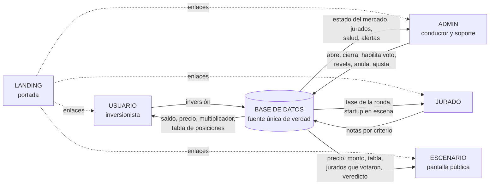
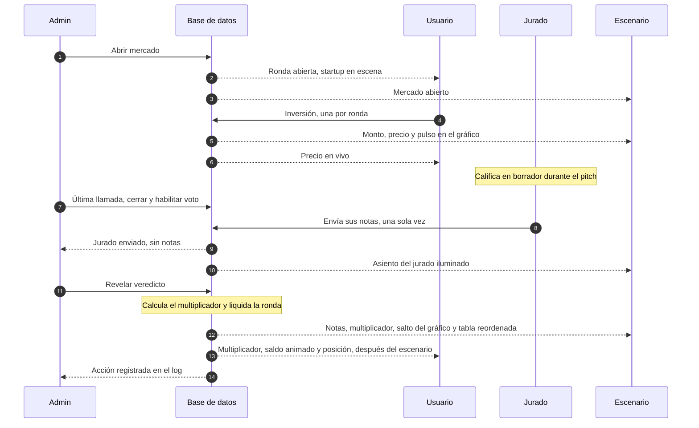

# Start Tank: decisiones de producto

Este documento reúne solo las decisiones definitivas sobre cada vista de la plataforma.

---

## 1. Vista de usuario

### 1.0 Ingreso
- El asistente ingresa solo con Google, mediante Neon Auth.

### 1.1 Panel de inversión
- Se abre con el botón **Invertir** como un modal de tamaño medio: ni pequeño ni de pantalla completa.
- Muestra la startup en escena, ya preseleccionada, con su **logo**, su **ODS** y una **breve descripción** en un costado.
- Incluye el campo de monto con atajos: `250`, `25%` y `Máx` (el tope del 30% del saldo).
- Incluye una vista previa de lo que recibiría el usuario si el jurado promedia 1, 2, 3, 4 y 5 sobre 5.
- La confirmación se hace en dos pasos, con un resumen de la operación, porque no se puede retirar.

### 1.2 Una sola inversión por ronda
- Cada usuario invierte **una sola vez** por ronda.
- Esa única inversión puede llegar hasta el tope del 30% del saldo.

### 1.3 Precio en vivo
- El precio en vivo de la startup se muestra en la vista del usuario.

### 1.4 Veredicto
- Al salir el veredicto, la pantalla sigue esta secuencia:
  1. Aparece el multiplicador, junto con el puntaje del jurado en porcentaje (por ejemplo, 78%).
  2. El saldo hace un conteo animado hasta su nuevo valor.
  3. El saldo se muestra en verde si sube y en ámbar si baja.
- No hay vibración en el teléfono.
- El escenario revela primero: en menos de 1 segundo desde que el admin revela.
- Todos los teléfonos revelan a la vez, 3 segundos después de que el admin revela. El tiempo se mide con la hora del servidor, para que ningún dispositivo se adelante.

### 1.5 Tabla de posiciones
- Muestra el top 3 de forma fija.
- Muestra una ventana con el usuario, 2 vecinos por arriba y 2 por abajo.
- Muestra la distancia al primer lugar y la distancia al podio.
- Muestra flechas de movimiento (↑ ↓) después de cada ronda.

### 1.6 Saldo al invertir
- Al invertir, el saldo baja de inmediato, sin esperar la siguiente consulta al servidor.
- Si el servidor rechaza la operación, el saldo se revierte y se avisa al usuario.

### 1.7 Espera entre rondas
- La pantalla "Esperando ronda N" muestra la siguiente startup (nombre y ODS) y el saldo disponible.

### 1.8 Racha de "mejor ojo"
- El usuario ve cuántas rondas ha acertado sobre las jugadas (por ejemplo, "acertaste 2 de 3 rondas").
- Un acierto es invertir en una startup cuyo multiplicador es mayor que 1.0x, es decir, que dio ganancia.

---

## 2. Vista del jurado

### 2.1 Calificación por criterios
- Cada jurado califica la startup en escena con una nota entera del **1 al 5** en cada uno de estos 4 criterios, todos con el mismo peso (25%):
  1. Problema y mercado.
  2. Modelo de negocio.
  3. Impacto ODS.
  4. Equipo y pitch.
- Cada nota lleva una frase de referencia visible (por ejemplo, "1 = no invertiría", "5 = invertiría hoy"), para que todos los jurados usen la escala igual.
- El puntaje de un jurado es el promedio ponderado de sus 4 notas.

### 2.2 Momento de calificar
- El jurado va calificando mientras la startup presenta y responde preguntas, y envía sus notas al final.
- Cada nota que pone se guarda en la base de datos como borrador, para no perderla si se apaga o se recarga el dispositivo.
- Cada jurado envía una sola vez por ronda.
- El jurado ve la fase de la ronda para saber cuándo puede enviar.
- El jurado puede calificar desde su laptop o desde su teléfono, con las mismas funciones en ambos.

### 2.3 Abstención
- El jurado puede abstenerse si declara conflicto de interés con la startup en escena.
- Una abstención se excluye del promedio.

### 2.4 Multiplicador
- No hay umbral de aprobación: el puntaje se usa de forma continua.
- Puntaje de la startup = promedio de los puntajes de los jurados que votaron.
- **Multiplicador = 0.2 + 1.6 × ((puntaje − 1) / 4)**.

| Puntaje del jurado | Multiplicador |
|---|---|
| 1 | 0.2x |
| 2 | 0.6x |
| 3 | 1.0x |
| 4 | 1.4x |
| 5 | 1.8x |

- Un puntaje intermedio da un multiplicador intermedio (por ejemplo, 4.4 da 1.5x).

### 2.5 Startup ganadora
- Puntaje final de la startup = 60% puntaje del jurado (convertido a porcentaje con `(puntaje − 1) / 4`) + 40% porcentaje de asistentes que invirtieron en ella.
- En caso de empate gana la startup con mayor puntaje del jurado.

---

## 3. Vista del escenario

### 3.1 Propósito
- Es la pantalla pública de solo lectura que se proyecta en el auditorio. Muestra en tiempo real las decisiones y operaciones importantes del evento.
- Tiene dos elementos principales: el gráfico de inversión y la tabla de inversores.

### 3.2 Gráfico de inversión
- Muestra el **monto acumulado** de la startup en escena. La curva sube con cada inversión y da un pulso cada vez que entra una.
- Al revelarse el veredicto, la curva termina con un salto final que muestra lo invertido contra lo que la sala recibe (por ejemplo, "62,000 → 86,800").

### 3.3 Tabla de inversores
- Va al costado del gráfico.
- Ordena a los inversores por **patrimonio** (saldo disponible + monto invertido).
- Se reordena al liquidar la ronda, con las filas animadas al subir y bajar, y flechas ↑ ↓ de movimiento.
- Muestra el **nombre real** del inversor, con la inicial del apellido (por ejemplo, "Diego P.").
- Durante la ronda muestra cuántos asistentes ya invirtieron (por ejemplo, "47 de 80").

### 3.4 Cinta de startups
- En la parte superior muestra las 5 startups con su multiplicador final a medida que cierran (por ejemplo, `AgroSense ▲1.4x`, `AguaClara ▼0.8x`).

### 3.5 Jurado en pantalla
- Muestra 4 asientos que se iluminan cuando cada jurado envía sus notas, sin revelar su sentido.
- Al revelar el veredicto, las 4 notas salen a la vez junto con el multiplicador.

### 3.6 Feed de eventos
La pantalla anuncia estos eventos:
- Apuesta grande.
- Hitos de monto acumulado (por ejemplo, "supera 50,000 IC").
- Último minuto.
- Mercado cerrado.
- Cantidad de jurados que han votado.
- Multiplicador actualizado.
- Fin de la ronda.
- Movimientos en la tabla de inversores.

### 3.7 Fluidez
- Los números y la curva se interpolan entre una consulta y la siguiente, para que no den saltos.

---

## 4. Vista del admin

### 4.1 Roles
- Hay dos roles de operador:
  - **Conductor:** ejecuta las acciones de ronda y los ajustes.
  - **Soporte:** solo ve la salud del sistema, las alertas y los usuarios, sin poder ejecutar acciones.

### 4.2 Control de ronda
- Un **botón principal contextual** sigue la máquina de estados: Abrir mercado → Última llamada → Cerrar → Habilitar voto → Revelar → Siguiente startup. Solo muestra el paso válido en cada momento.
- **Revelar veredicto** queda bloqueado hasta que los 4 jurados envíen sus notas.
- Si un jurado se desconecta, el conductor puede **revelar con los jurados presentes**, tras una confirmación.
- Cada fase tiene un **cronómetro** con duración configurable, y botones de `+1 min` y `pausa`.
- Con la ronda en pausa, el cronómetro se congela y el botón de invertir queda bloqueado con el mensaje "Mercado en pausa". Al reanudar, el cronómetro sigue con el tiempo que quedaba.
- Cada ronda dura **20 minutos en total**, repartidos así: pitch de 5 minutos, toma y dame de 10, última llamada de 1, votación del jurado de 2.5 y resultado de 1.5.
- Durante el pitch y el toma y dame, el mercado está abierto y el jurado puede calificar en borrador.
- Un indicador muestra cuánto va adelantado o atrasado el evento respecto al programa de 14:30 a 17:00.

### 4.3 Lectura en vivo
- **Mercado:** monto acumulado, precio, inversores únicos y porcentaje de la sala que ya invirtió.
- **Jurados:** cada uno aparece como conectado, pendiente o enviado.
- El admin **no ve las notas** de los jurados antes de revelar el veredicto.
- **Asistentes:** cantidad de conectados y de billeteras creadas, con un buscador para ver el saldo de un usuario.

### 4.4 Ajustes durante el evento
Todos piden confirmación y motivo, y quedan en el log de acciones.
- Anular ronda, devolviendo lo invertido o liquidando a 1x.
- Liquidación manual.
- Exportación de saldos y posiciones en cada liquidación.
- Congelar el resultado en el último corte liquidado.
- Ajuste manual de saldo de un usuario, con motivo obligatorio.

### 4.5 Alertas y salud
- Un **semáforo permanente** en la parte superior muestra el estado de la base de datos, los jurados y los teléfonos.
- Cada alerta aparece con banner rojo y sonido, y con su **acción sugerida** al lado:
  - Liquidación fallida → reintentar.
  - Latencia mayor a 1 s.
  - Jurado desconectado.
  - Muchas inversiones rechazadas.
- El **modo manual** se activa con un toque: congela el ranking, lo marca en la pantalla y activa el plan de conteo a mano.

### 4.6 Log de acciones
- Cada acción queda registrada con su hora y el operador que la ejecutó.

### 4.7 Configuración
- Solo se puede modificar cuando no hay una ronda abierta.
- Incluye:
  - Startups: orden, logo, descripción y ODS.
  - Jurados y sus códigos de acceso.
  - Criterios de calificación.
  - Límites del dinero: capital inicial, compra mínima, tope por ronda y rango de precio.
  - Duración de cada fase.

### 4.8 Antes del evento
- Un **checklist previo** se pone en verde cuando se cumple todo esto:
  - 5 startups cargadas.
  - 4 jurados con código.
  - Base de datos y login de Neon respondiendo.
- El **modo ensayo** reinicia los datos para los ensayos. Queda bloqueado una vez iniciado el evento real.

---

## 5. Conexión entre vistas

### 5.1 Reglas de conexión
- La **base de datos es el único punto de encuentro**. Las vistas no se comunican entre sí: cada una escribe sus acciones en la base y lee el estado desde ella.
- **Cada dato tiene un solo dueño**, el que lo escribe:

| Dato | Dueño |
|---|---|
| Inversión | Usuario |
| Notas y abstención | Jurado |
| Estado de la ronda, tiempos y ajustes | Admin |
| Precio y monto acumulado | Base de datos, al registrar cada inversión |
| Multiplicador, liquidación, saldos, tabla de posiciones y puntaje de la ganadora | Base de datos, al revelar el veredicto |

- El **multiplicador se calcula en un solo lugar**: la función de base de datos que revela el veredicto. Ninguna vista lo calcula por su cuenta.
- La **fase de la ronda gobierna lo que puede hacer cada vista**: el usuario invierte solo con el mercado abierto, el jurado envía solo en votación, el admin solo ve el paso válido y el escenario muestra la fase.
- Las **notas de los jurados permanecen ocultas** hasta que se revela el veredicto: ni el admin ni el escenario las ven antes.
- Ninguna vista ejecuta acciones de otra: cada rol entra a su propio portal.
- En la revelación, el **escenario muestra el veredicto antes que los teléfonos**.
- Todas las vistas se actualizan con consultas periódicas e interpolan los números entre una consulta y la siguiente.
- Los cronómetros y la sincronización entre vistas usan la hora del servidor, no la del dispositivo.
- La sesión se mantiene con una cookie que vence a las **2 horas** para los asistentes, a las **3 horas** para los jurados y a las **4 horas** para los operadores.
- Si algo falla, el **admin recibe la alerta**. El modo manual congela todas las vistas en el último corte liquidado y la pantalla lo marca.

### 5.2 Esquema general

### 5.3 Qué escribe y qué lee cada vista

| Vista | Escribe | Lee |
|---|---|---|
| Landing | Nada | Información del evento. Enlaza a los demás portales. |
| Usuario | Su inversión, una por ronda | Startup en escena, precio, saldo, multiplicador, tabla de posiciones, historial y aciertos |
| Jurado | Notas por criterio y abstención | Fase de la ronda y startup en escena |
| Admin | Acciones de ronda, tiempos, ajustes y configuración | Estado del mercado, estado de los jurados (sin notas), asistentes, salud, alertas y log |
| Escenario | Nada | Precio, monto acumulado, tabla de inversores, jurados que votaron, veredicto, cinta de startups y feed de eventos |

### 5.4 Una ronda de principio a fin

