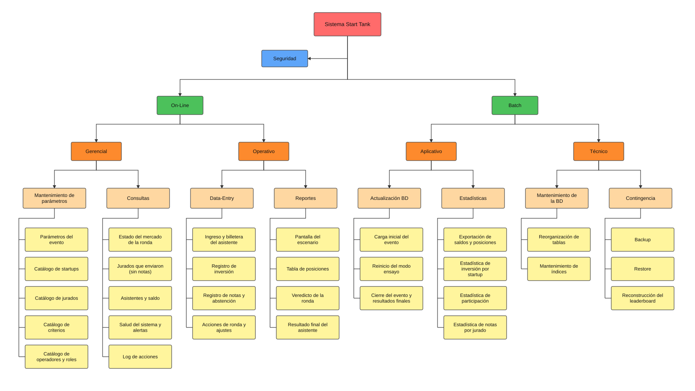
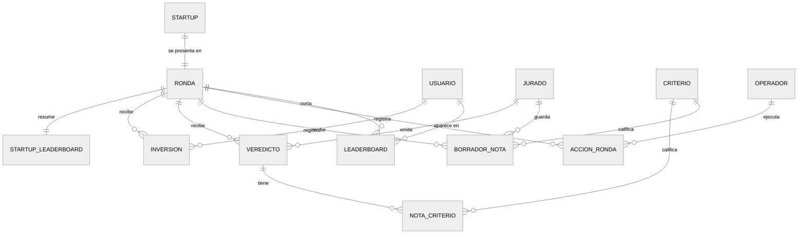
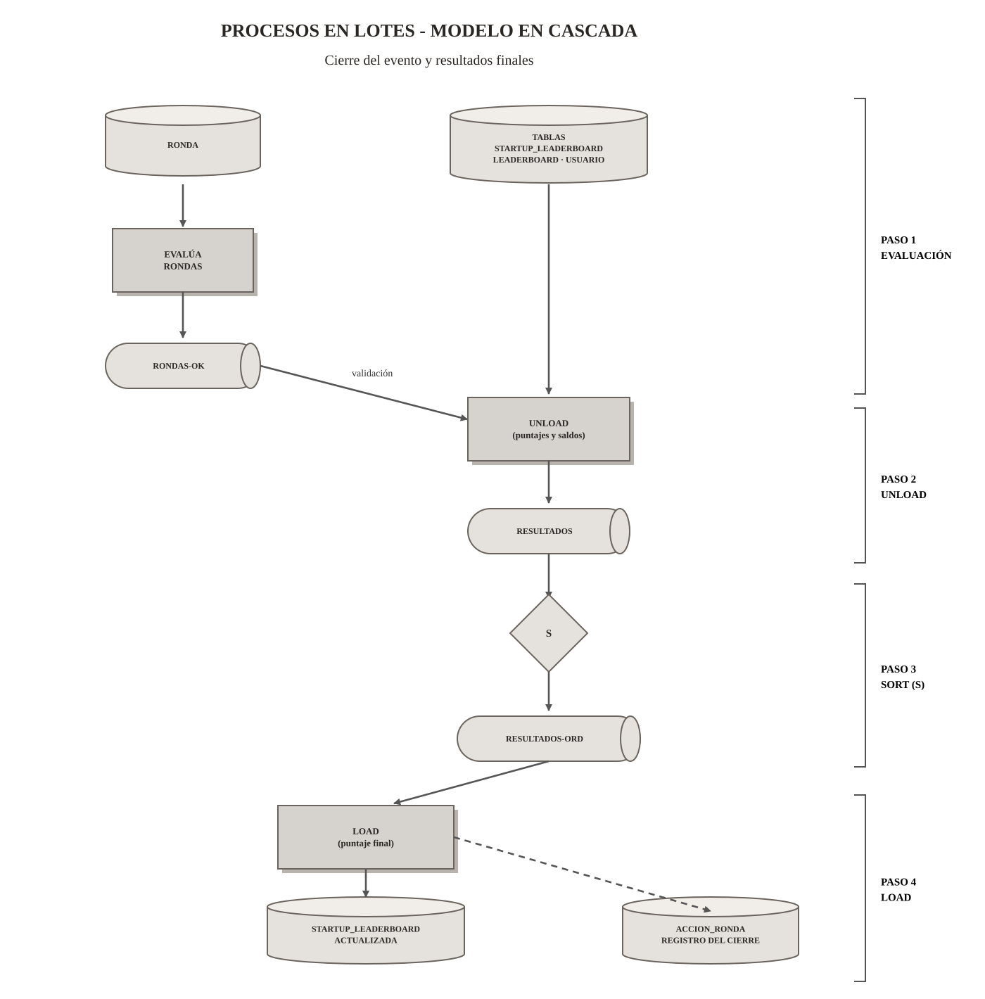

# Start Tank: base de datos

Este documento describe cómo se organiza la base de datos y los dos modos en que opera: **On-Line** (durante el evento, cada acción del usuario) y **Batch** (procesos en lote antes y después del evento). Parte de la base actual en `start-tank-app/db` y de las decisiones de [BASES.md](BASES.md).

En las tablas se marca lo que cambia respecto a la base actual: **(nueva tabla)**, **(modificada)** y **(nuevo)** para un atributo nuevo.

---

## 1. Arquitectura On-Line y Batch

| Módulo | Parte | Qué incluye |
|---|---|---|
| **On-Line** | Gerencial | Lo que configura y consulta el equipo organizador desde Admin: parámetros y catálogos, y consultas de estado. |
| | Operativo | Lo que ocurre durante el evento: registro de inversiones y notas, acciones de ronda, y los reportes que ven el escenario, el jurado y el usuario. |
| **Batch** | Aplicativo | Procesos de datos del evento: carga inicial, reinicio del ensayo, cierre del evento y estadísticas. |
| | Técnico | Cuidado de la base: mantenimiento de índices, backup, restore y reconstrucción. |
| **Seguridad** | | Asistentes entran con Google (Neon Auth). Jurados y operadores entran con código personal. La sesión es una cookie de 2 horas para asistentes, 3 para jurados y 4 para operadores. El operador tiene rol Conductor o Soporte. |

---

## 2. Tablas

Convención: **PK** clave primaria, **FK** clave foránea, **AK** clave alterna (valor único). Un número junto a AK (AK1, AK2) indica claves distintas.

`configuracion` no se relaciona con otras tablas: guarda parámetros sueltos.

### 2.1 Resumen y dónde opera cada tabla

| Tabla | Descripción | Opera en |
|---|---|---|
| `usuario` | Asistente con su billetera. | **On-Line:** ingreso, inversión y saldo. **Batch:** UNLOAD de saldos al cierre y reinicio del ensayo. |
| `jurado` | Los 4 jurados y su código. | **On-Line:** acceso y envío de notas. **Batch:** carga inicial. |
| `operador` | Conductor y soporte, con su código. | **On-Line:** acceso a Admin. **Batch:** carga inicial. |
| `startup` | Las 5 startups. | **On-Line:** consulta y configuración. **Batch:** carga inicial. |
| `criterio` | Los 4 criterios del jurado. **(nueva tabla)** | **On-Line:** calificación y configuración. **Batch:** carga inicial y estadísticas. |
| `configuracion` | Parámetros del evento y banderas del sistema. **(nueva tabla)** | **On-Line:** todas las vistas leen y Admin edita. **Batch:** reinicio del ensayo. |
| `ronda` | Una ronda por startup, con su estado y multiplicador. | **On-Line:** ciclo de la ronda. **Batch:** validación al cierre. |
| `inversion` | La inversión de cada asistente en cada ronda. | **On-Line:** registro y liquidación. **Batch:** estadísticas y reinicio. |
| `veredicto` | El envío de un jurado en una ronda. **(modificada)** | **On-Line:** envío de notas. **Batch:** estadística de notas. |
| `nota_criterio` | La nota de 1 a 5 por criterio. **(nueva tabla)** | **On-Line:** envío de notas. **Batch:** estadística de notas. |
| `borrador_nota` | La última nota que el jurado puso en cada criterio, antes de enviar. **(nueva tabla)** | **On-Line:** cada nota que pone el jurado. **Batch:** reinicio del ensayo. |
| `accion_ronda` | Log de las acciones del operador. **(modificada)** | **On-Line:** cada acción y ajuste. **Batch:** registro del cierre. |
| `leaderboard` | Posición y saldo de cada asistente al cierre de cada ronda. | **On-Line:** liquidación y tabla de posiciones. **Batch:** resultados finales y reconstrucción. |
| `startup_leaderboard` | Monto, precio y puntaje de cada startup. **(modificada)** | **On-Line:** precio y monto en vivo. **Batch:** puntaje final. |

### 2.2 Cambios respecto a la base actual

- **Tablas nuevas:** `criterio`, `nota_criterio`, `borrador_nota` y `configuracion`. Hacen falta porque las notas pasan a ser del 1 al 5 en 4 criterios configurables, porque el jurado guarda su borrador en la base, y porque Admin edita los límites y las duraciones.
- **`ronda`:** `fase_termina_en` (hora del servidor en que termina la fase actual, de donde salen los cronómetros de todas las vistas) y `segundos_restantes_pausa` (lo que faltaba al pausar, vacío si no hay pausa).
- **`veredicto`:** `decision` (respalda, rechaza, se abstiene) se reemplaza por `se_abstiene` y `puntaje`.
- **`inversion`:** una inversión por asistente y ronda.
- **`startup_leaderboard`:** `fraccion_respaldo` se reemplaza por `puntaje_jurado`.
- **`usuario`, `jurado`:** `ultima_conexion`, para mostrar quién está conectado.
- **`operador`:** `rol`, para separar Conductor y Soporte.
- **`startup`:** `logo_url`, porque el panel de inversión muestra el logo.
- **`accion_ronda`:** `motivo`, porque los ajustes y el rescate lo exigen.
- **Se proponen retirar** por no usarse en ninguna vista: `usuario.rubro`, `usuario.estado`, los `creado_en` de `usuario`, `jurado` y `operador`, y los `actualizado_en` de las dos tablas leaderboard.

### 2.3 Tablas maestras

**usuario**

| Atributo | Tipo | Clave o nota |
|---|---|---|
| id_usuario | bigint | PK |
| proveedor_oauth | varchar | AK1 |
| id_externo | varchar | AK1 |
| correo | varchar | |
| nombre | varchar | |
| saldo_actual | numeric | Billetera, nunca menor que 0 |
| ultima_conexion | timestamp | (nuevo) |

**jurado**

| Atributo | Tipo | Clave o nota |
|---|---|---|
| id_jurado | bigint | PK |
| codigo_acceso | varchar | AK |
| nombre | varchar | |
| organizacion | varchar | |
| ultima_conexion | timestamp | (nuevo) |

**operador**

| Atributo | Tipo | Clave o nota |
|---|---|---|
| id_operador | bigint | PK |
| codigo_acceso | varchar | AK |
| nombre | varchar | |
| rol | varchar | (nuevo) CONDUCTOR o SOPORTE |

**startup**

| Atributo | Tipo | Clave o nota |
|---|---|---|
| id_startup | bigint | PK |
| orden_presentacion | smallint | AK |
| nombre | varchar | |
| ods | varchar | |
| descripcion | varchar | |
| logo_url | varchar | (nuevo) |

**criterio** (nueva tabla)

| Atributo | Tipo | Clave o nota |
|---|---|---|
| id_criterio | bigint | PK |
| nombre | varchar | AK |
| peso | numeric | 0.25 en cada uno de los 4 criterios |
| ancla_min | varchar | Frase de la nota 1, por ejemplo "no convence" |
| ancla_max | varchar | Frase de la nota 5, por ejemplo "invertiría hoy" |

**configuracion** (nueva tabla)

Guarda los límites del dinero (capital inicial, compra mínima, tope por ronda, rango de precio), la duración de cada fase, el retraso de los teléfonos al revelar el veredicto (3 segundos) y las banderas `evento_iniciado` y `modo_manual`.

| Atributo | Tipo | Clave o nota |
|---|---|---|
| clave | varchar | PK |
| valor | varchar | |

### 2.4 Tablas de movimiento y resultado

**ronda**

| Atributo | Tipo | Clave o nota |
|---|---|---|
| id_ronda | bigint | PK |
| id_startup | bigint | FK a `startup`, AK1 |
| numero | smallint | AK2 |
| estado | varchar | PROGRAMADA, ABIERTA, ULTIMA_LLAMADA, CERRADA, EN_VOTACION, LIQUIDADA o ANULADA |
| multiplicador | numeric | Se llena al liquidar |
| abierta_en | timestamp | |
| ultima_llamada_en | timestamp | |
| cerrada_en | timestamp | |
| liquidada_en | timestamp | Hora del servidor en que se revela el veredicto. De aquí parten el escenario y los teléfonos |
| fase_termina_en | timestamp | (nuevo) Hora del servidor en que termina la fase actual |
| segundos_restantes_pausa | integer | (nuevo) Segundos que faltaban al pausar. Vacío si la ronda no está en pausa |

**inversion** (modificada)

| Atributo | Tipo | Clave o nota |
|---|---|---|
| id_inversion | bigint | PK |
| id_usuario | bigint | FK a `usuario`, AK |
| id_ronda | bigint | FK a `ronda`, AK |
| monto | numeric | Mínimo 250 IC |
| precio_momento | numeric | Precio de entrada |
| retorno | numeric | Monto × multiplicador, se llena al liquidar |
| estado | varchar | |
| creada_en | timestamp | Sirve para dibujar la curva del escenario |

`(id_usuario, id_ronda)` es la clave alterna: una sola inversión por asistente y ronda.

**veredicto** (modificada)

| Atributo | Tipo | Clave o nota |
|---|---|---|
| id_veredicto | bigint | PK |
| id_jurado | bigint | FK a `jurado`, AK |
| id_ronda | bigint | FK a `ronda`, AK |
| se_abstiene | boolean | (nuevo) Reemplaza a `decision` |
| puntaje | numeric | (nuevo) Promedio ponderado de sus 4 notas. Vacío si se abstiene |
| emitido_en | timestamp | |

`(id_jurado, id_ronda)` es la clave alterna: un solo envío por jurado y ronda.

**nota_criterio** (nueva tabla)

| Atributo | Tipo | Clave o nota |
|---|---|---|
| id_veredicto | bigint | PK, FK a `veredicto` |
| id_criterio | bigint | PK, FK a `criterio` |
| valor | smallint | Entero de 1 a 5 |

**borrador_nota** (nueva tabla)

Cada nota que el jurado pone se guarda aquí y reemplaza a la anterior del mismo criterio. Al enviar, se pasan a `nota_criterio` y el borrador se borra.

| Atributo | Tipo | Clave o nota |
|---|---|---|
| id_jurado | bigint | PK, FK a `jurado` |
| id_ronda | bigint | PK, FK a `ronda` |
| id_criterio | bigint | PK, FK a `criterio` |
| valor | smallint | Entero de 1 a 5 |

**accion_ronda** (modificada)

| Atributo | Tipo | Clave o nota |
|---|---|---|
| id_accion | bigint | PK |
| id_operador | bigint | FK a `operador` |
| id_ronda | bigint | FK a `ronda` |
| accion | varchar | |
| motivo | varchar | (nuevo) Obligatorio en ajustes y rescate |
| ejecutada_en | timestamp | |

**leaderboard**

| Atributo | Tipo | Clave o nota |
|---|---|---|
| id_leaderboard | bigint | PK |
| id_ronda | bigint | FK a `ronda`, AK |
| id_usuario | bigint | FK a `usuario`, AK |
| posicion | smallint | |
| saldo | numeric | Patrimonio al cierre de la ronda |
| ganancia_ronda | numeric | |
| aciertos | smallint | Rondas en que invirtió en una startup con más de 1.0x |

**startup_leaderboard** (modificada)

| Atributo | Tipo | Clave o nota |
|---|---|---|
| id_startup_leaderboard | bigint | PK |
| id_ronda | bigint | FK a `ronda`, AK |
| id_startup | bigint | FK a `startup` |
| monto_acumulado | numeric | Se actualiza en cada inversión |
| inversores_unicos | integer | Se actualiza en cada inversión |
| precio_vivo | numeric | Entre 50 y 200 |
| puntaje_jurado | numeric | (nuevo) Promedio de los jurados. Reemplaza a `fraccion_respaldo` |
| puntaje | numeric | Puntaje final: 60% jurado y 40% tracción |

---

## 3. Módulo On-Line

**Proceso principal: ronda de inversión y veredicto.** Se repite en cada una de las 5 rondas. Cada paso es una transacción corta y los pasos 4, 8 y 10 son funciones de la base de datos.

| Paso | Quién | Qué ocurre | Tablas |
|---|---|---|---|
| 1 | Admin | Abre el mercado. Solo si la ronda anterior está liquidada o anulada. La ronda pasa a ABIERTA. | Lee `ronda`. Escribe `ronda` y `accion_ronda`. |
| 2 | Usuario, Jurado, Escenario | Consultan cada 2 o 3 segundos la fase, la startup, el precio y las posiciones. | Leen `ronda`, `startup`, `startup_leaderboard`, `usuario`, `leaderboard`. |
| 3 | Jurado | Califica en borrador. Cada nota que pone se guarda de inmediato en la base, para no perderla si se apaga el dispositivo. | Escribe `borrador_nota`. |
| 4 | Usuario | Registra su inversión (`fn_registrar_inversion`). Se bloquea su saldo y se valida: ronda abierta, que no haya invertido ya en esa ronda, monto mínimo y tope del 30%. Si pasa, descuenta el saldo, registra la inversión y sube el monto y el precio. | Lee y escribe `usuario`. Escribe `inversion` y `startup_leaderboard`. |
| 5 | Admin | Anuncia la última llamada. La ronda pasa a ULTIMA_LLAMADA. | Escribe `ronda` y `accion_ronda`. |
| 6 | Admin | Cierra el mercado. La ronda pasa a CERRADA. Ya no entran inversiones. | Escribe `ronda` y `accion_ronda`. |
| 7 | Admin | Habilita el voto. La ronda pasa a EN_VOTACION. | Escribe `ronda` y `accion_ronda`. |
| 8 | Jurado | Envía sus notas (`fn_registrar_voto`). Se valida que la ronda esté en votación y que no haya enviado antes. Se guarda el envío con su puntaje y las 4 notas, y se borra el borrador. Si se abstiene, no lleva puntaje ni notas. | Escribe `veredicto` y `nota_criterio`. Lee `criterio`. Borra `borrador_nota`. |
| 9 | Admin | Ve cuántos jurados enviaron, sin ver las notas. Revelar se habilita con los 4 envíos o con el rescate (confirmación y motivo). | Lee `veredicto`. Escribe `accion_ronda` si hay rescate. |
| 10 | Admin | Revela el veredicto (`fn_revelar_veredicto`). En una sola transacción: bloquea la ronda, calcula el puntaje y el multiplicador, liquida cada inversión, acredita los saldos, arma la tabla de posiciones y marca la ronda como LIQUIDADA. Si ya estaba liquidada, no hace nada. | Lee `veredicto`. Escribe `ronda`, `inversion`, `usuario`, `leaderboard`, `startup_leaderboard` y `accion_ronda`. |
| 11 | Escenario, Usuario, Jurado | Leen el resultado. El escenario lo muestra primero, en menos de 1 segundo. Todos los teléfonos lo muestran a la vez, 3 segundos después de `liquidada_en`. | Leen `ronda`, `veredicto`, `leaderboard`, `startup_leaderboard`. |
| 12 | Admin | Pasa a la siguiente startup (vuelve al paso 1). Tras la ronda 5, cierra el evento y arranca el proceso Batch. | Escribe `accion_ronda`. |

Cálculo del paso 10:

- **Puntaje de la startup** = promedio de los puntajes de los jurados que votaron. Las abstenciones no cuentan.
- **Multiplicador** = 0.2 + 1.6 × ((puntaje − 1) / 4).
- **Retorno** de cada inversión = monto × multiplicador.
- **Acierto** = inversión en una startup con multiplicador mayor que 1.0.

---

## 4. Módulo Batch

**Proceso principal: cierre del evento y resultados finales.** Lo dispara el conductor con **Cerrar evento** después de la ronda 5. Calcula el puntaje final de cada startup, de donde salen la startup ganadora, el top 3 y el mejor ojo.

| Paso | Operación | Qué hace | Entrada y salida |
|---|---|---|---|
| 1 | **Evalúa rondas** | Revisa que las 5 rondas estén liquidadas o anuladas. Si falta alguna, el proceso se detiene y avisa al Admin. | `ronda` → `RONDAS-OK` |
| 2 | **UNLOAD** | Extrae por cada startup el puntaje del jurado y los inversores únicos, la cantidad de asistentes, y el saldo y los aciertos de la última tabla de posiciones. Calcula el puntaje final: 0.6 × ((puntaje del jurado − 1) / 4) + 0.4 × (inversores únicos ÷ asistentes). Guarda también una copia de respaldo. | `startup_leaderboard`, `leaderboard`, `usuario` → `RESULTADOS` |
| 3 | **SORT** | Ordena las startups por puntaje final, de mayor a menor. Si empatan, gana la de mayor puntaje del jurado. Ordena a los asistentes por saldo, de mayor a menor. | `RESULTADOS` → `RESULTADOS-ORD` |
| 4 | **LOAD** | Carga el puntaje final de cada startup. La primera del orden es la ganadora. El top 3 son los 3 primeros asistentes y el mejor ojo es quien más aciertos tiene. Registra la ejecución. Si el LOAD falla, se hace **RESTORE** de la copia del paso 2 y se reintenta. | `RESULTADOS-ORD` → `startup_leaderboard`, `accion_ronda` |

### 4.1 Otros procesos batch

| Proceso | Módulo | Operaciones | Cuándo |
|---|---|---|---|
| Carga inicial del evento | Aplicativo, Actualización BD | LOAD de startups, jurados, operadores, criterios y configuración desde archivo. | Antes del evento |
| Reinicio del modo ensayo | Aplicativo, Actualización BD | UNLOAD de respaldo, borrado de inversiones, veredictos y posiciones, y saldos de vuelta a 10,000 IC. | Antes de iniciar el evento. Después queda bloqueado |
| Exportación de saldos y posiciones | Aplicativo, Estadísticas | UNLOAD de `leaderboard` y SORT por posición. | Tras cada liquidación y al cierre |
| Estadísticas del evento | Aplicativo, Estadísticas | UNLOAD y SORT de inversión por startup, participación y notas por jurado. | Tras el cierre |
| Backup | Técnico, Contingencia | UNLOAD de todas las tablas. | Antes del evento y tras cada ronda |
| Restore | Técnico, Contingencia | RESTORE del último respaldo. | Si la base falla durante el evento |
| Reconstrucción del leaderboard | Técnico, Contingencia | Recalcula las dos tablas leaderboard desde `inversion`, `veredicto` y `nota_criterio`. | Si se pierde un corte |
| Mantenimiento de índices y reorganización | Técnico, Mantenimiento de la BD | Reconstruye los índices y reorganiza las tablas. | Después del evento |
