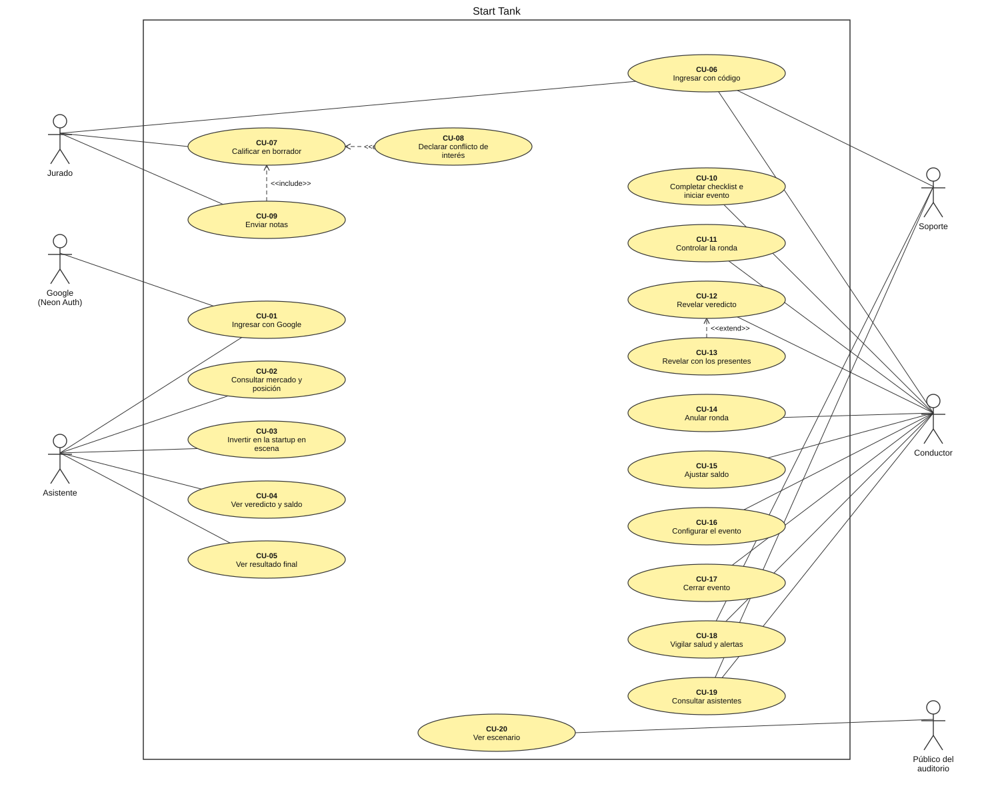
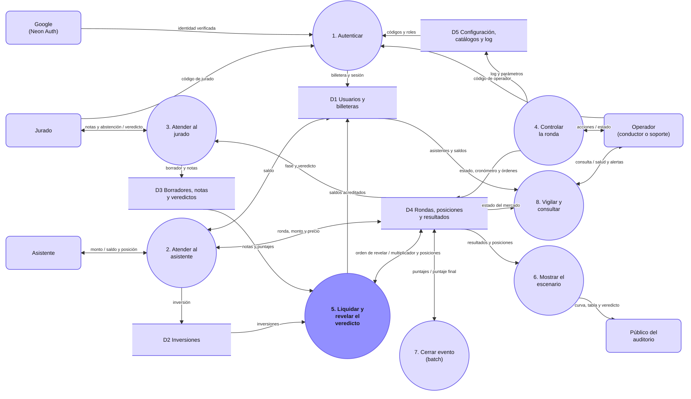

# Start Tank: especificación de requisitos (SRS)

IC significa Impact Coins. Los requisitos parten de [BASES.md](BASES.md), [ARCHITECTURE.md](ARCHITECTURE.md) y [DATABASE.md](DATABASE.md).

---

## 1. Requisitos funcionales

| Requisito | Descripción | Ejemplo |
|---|---|---|
| RF-01 | El sistema deberá autenticar al asistente con su cuenta de Google y crear su billetera con 10,000 IC en su primer ingreso. | Si Valeria entra por primera vez con su cuenta de Google y autoriza el acceso, el sistema crea su billetera y muestra un saldo de 10,000 IC. |
| RF-02 | El sistema deberá asociar una sola billetera a cada cuenta de Google y recuperar su saldo vigente en los ingresos posteriores. | Si Valeria cierra el navegador en la ronda 3 y vuelve a entrar con la misma cuenta, el sistema le muestra 13,200 IC y no crea una billetera nueva. |
| RF-03 | El sistema deberá autenticar a jurados y operadores con su código personal y asignarles su rol: jurado, conductor o soporte. | Si un operador escribe un código con rol Soporte, el sistema abre la consola en modo de solo lectura. |
| RF-04 | El sistema deberá mantener la sesión con una cookie que vence a las 2 horas para asistentes, a las 3 para jurados y a las 4 para operadores. | Si un jurado ingresa a las 13:30, el sistema mantiene su sesión hasta las 16:30 y luego le pide su código de nuevo. |
| RF-05 | El sistema deberá rechazar toda acción que no corresponda al rol de quien la pide. | Si un jurado intenta cerrar el mercado desde su portal, el sistema rechaza la petición y la ronda sigue abierta. |
| RF-06 | El sistema deberá controlar el ciclo de cada ronda (abrir, última llamada, cerrar, habilitar voto, revelar y pasar a la siguiente startup) y mostrar al conductor solo el paso válido. | Si la ronda 2 está programada, el conductor ve solo el botón Abrir mercado y, al pulsarlo, el sistema cambia la ronda a Abierta. |
| RF-07 | El sistema deberá mostrar en todas las vistas un cronómetro por fase basado en la hora del servidor, y permitir al conductor sumar 1 minuto o pausar la fase. | Si el conductor pausa con 01:30 restantes y reanuda después, el sistema retoma el cronómetro desde 01:30 y bloquea las inversiones mientras dura la pausa. |
| RF-08 | El sistema deberá cerrar el mercado cuando venza la última llamada. | Cuando se cumple el minuto de última llamada de la ronda 3, el sistema cambia la ronda a Cerrada y rechaza nuevas inversiones. |
| RF-09 | El sistema deberá registrar cada acción del conductor con su nombre, la hora y el motivo cuando corresponda. | Si Diego cierra el mercado de la ronda 3 a las 15:08, el sistema guarda en el log a Diego, la acción Cerrar y la hora 15:08. |
| RF-10 | El sistema deberá permitir al conductor anular una ronda, devolviendo lo invertido o liquidando a 1x. | Si el conductor anula la ronda 2 devolviendo lo invertido, el sistema regresa los 3,000 IC de Juanita a su saldo y marca la ronda como Anulada. |
| RF-11 | El sistema deberá permitir al conductor ajustar el saldo de un asistente con un motivo obligatorio. | Si el conductor suma 500 IC al saldo de Juanita por un error del sistema y escribe el motivo, el sistema actualiza el saldo y deja el ajuste en el log. |
| RF-12 | El sistema deberá rechazar la inversión de un asistente cuando el mercado esté cerrado o en pausa, el monto sea menor que 250 IC o mayor que el 30% del saldo con que abrió la ronda, o ya haya invertido en esa ronda. | Si Juanita abrió la ronda 3 con 12,400 IC e intenta invertir 4,000 IC, el sistema rechaza la operación y le indica que el máximo es 3,720 IC. |
| RF-13 | El sistema deberá registrar la inversión aceptada en una sola transacción: descuenta el saldo, suma el monto y los inversores únicos de la startup, y actualiza su precio entre 50 y 200. | Si Juanita invierte 3,000 IC con un saldo de 12,400 IC, el sistema deja su saldo en 9,400 IC, suma 3,000 IC al monto de la startup y sube su precio en vivo. |
| RF-14 | El sistema deberá guardar en la base de datos cada nota de 1 a 5 que el jurado pone en cada criterio. | Si el jurado Ramírez califica con 4 el criterio Impacto ODS y recarga la página, el sistema le vuelve a mostrar ese 4. |
| RF-15 | El sistema deberá registrar la abstención de un jurado por conflicto de interés y excluirla del promedio. | Si el jurado Soto declara conflicto con AguaClara, el sistema registra su abstención y calcula el puntaje de la startup con los otros tres jurados. |
| RF-16 | El sistema deberá aceptar un solo envío de notas por jurado y ronda, solo con la votación habilitada, y calcular su puntaje como el promedio de sus 4 criterios. | Si el jurado Ramírez envía 4, 3, 5 y 4, el sistema registra su puntaje de 4.0 y rechaza un segundo envío en esa ronda. |
| RF-17 | El sistema deberá mantener ocultas las notas de los jurados hasta que se revele el veredicto. | Si el jurado Ramírez ya envió, el sistema muestra al conductor y al escenario que ese jurado envió, pero no muestra su puntaje. |
| RF-18 | El sistema deberá mantener bloqueado Revelar veredicto hasta que los 4 jurados envíen, y permitir revelar con los jurados presentes con confirmación y motivo. | Si solo 3 jurados enviaron, el botón sigue bloqueado y el conductor puede revelar con los 3 presentes escribiendo que el jurado 3 perdió la conexión. |
| RF-19 | El sistema deberá calcular el puntaje de la startup como el promedio de los jurados que votaron y su multiplicador como 0.2 + 1.6 × ((puntaje − 1) / 4). | Si los jurados que votaron promedian 4.0, el sistema calcula un multiplicador de 1.4x. |
| RF-20 | El sistema deberá liquidar cada inversión como monto × multiplicador, acreditar el retorno al saldo y marcar la ronda como Liquidada en una sola transacción, sin repetirla si ya estaba liquidada. | Si Juanita invirtió 3,000 IC y el multiplicador es 1.4x, el sistema le acredita 4,200 IC y registra una ganancia de 1,200 IC. |
| RF-21 | El sistema deberá calcular al liquidar la posición de cada asistente por patrimonio, su ganancia de la ronda y sus aciertos, donde un acierto es invertir en una startup con multiplicador mayor que 1.0. | Si Juanita termina la ronda 3 con 13,200 IC y fue su segundo acierto, el sistema le asigna su posición, una ganancia de 1,200 IC y 2 aciertos. |
| RF-22 | El sistema deberá mostrar el veredicto en el escenario en menos de 1 segundo desde que el conductor lo revela, y en todos los teléfonos a la vez, 3 segundos después. | Si el conductor revela a las 15:08:00, el escenario muestra el veredicto antes de las 15:08:01 y los teléfonos lo muestran a las 15:08:03. |
| RF-23 | El sistema deberá mostrar al asistente la startup en escena con su precio en vivo, su saldo, su posición con 2 vecinos por arriba y 2 por abajo, su distancia al primero y al podio, y su racha de aciertos. | Si Diego está en el puesto 7, el sistema muestra los puestos 5 al 9, que está a 2,480 IC del primero y a 640 IC del podio, y que acertó 1 de 1 rondas. |
| RF-24 | El sistema deberá mostrar al asistente, antes de confirmar su inversión, lo que recibiría con puntajes de 1 a 5, y pedir la confirmación en dos pasos. | Si Diego escribe 3,000 IC, el sistema le muestra que recibiría 4,200 IC con un puntaje de 4 y registra la inversión solo cuando confirma en el segundo paso. |
| RF-25 | El sistema deberá mostrar en el escenario, sin autenticación y sin escrituras, la curva de monto acumulado, la tabla de inversores por patrimonio con su movimiento, la cinta de startups, los asientos del jurado y los eventos recientes. | Si entra una inversión de 3,000 IC en AguaClara, la curva sube un escalón y el feed muestra una apuesta grande en AguaClara. |
| RF-26 | El sistema deberá mostrar al conductor y al soporte el estado del mercado, los jurados que enviaron (sin sus notas), los asistentes conectados y las alertas de salud con su acción sugerida. | Si un jurado deja de responder por 45 segundos, el sistema muestra la alerta Jurado desconectado y la opción de revelar con los presentes. |
| RF-27 | El sistema deberá permitir al conductor activar el modo manual, que congela el ranking en el último corte liquidado y lo marca en la pantalla. | Si la aplicación no responde por más de 90 segundos en la ronda 4, el conductor activa el modo manual y el sistema publica el resultado de la ronda 3 como vigente. |
| RF-28 | El sistema deberá permitir al conductor editar los límites del dinero, la duración de las fases, las startups, los jurados y los criterios solo cuando no haya una ronda abierta. | Si el conductor cambia el tope por ronda de 30% a 25% con la ronda 2 programada, el sistema guarda el cambio, y lo rechaza si la ronda 2 está abierta. |
| RF-29 | El sistema deberá mostrar al conductor un checklist previo (5 startups, 4 jurados, base de datos y login respondiendo), habilitar Iniciar evento solo con todo en verde y bloquear el modo ensayo una vez iniciado el evento. | Si falta cargar una startup, el sistema muestra ese punto en rojo y mantiene bloqueado Iniciar evento. Con el evento iniciado, rechaza reiniciar los datos de ensayo. |
| RF-30 | El sistema deberá cerrar el evento calculando el puntaje final de cada startup (60% del puntaje del jurado y 40% de los asistentes que invirtieron en ella), la ganadora, el top 3 de inversionistas y el mejor ojo. | Si SolRed obtiene 4.4 de 5 del jurado y el 78% de los asistentes invirtió en ella, el sistema calcula 0.82 y la declara ganadora. Ante un empate gana la de mayor puntaje del jurado. |
| RF-31 | El sistema deberá exportar los saldos y las posiciones de los asistentes al liquidar cada ronda y al cerrar el evento. | Si el sistema liquida la ronda 3, genera un archivo con los saldos y las posiciones de los asistentes en ese momento. |

---

## 2. Requisitos no funcionales

| Requisito | Descripción | Métrica | Umbral | Condición | Estándar ISO/IEC 25010 |
|---|---|---|---|---|---|
| RNF-01 | El sistema deberá atender al menos 100 sesiones simultáneas sin errores durante una ronda con el mercado abierto. | Sesiones simultáneas atendidas sin error | 100 o más sesiones y 0 errores | Mercado abierto, con cada teléfono consultando cada 3 segundos | Eficiencia de desempeño (capacidad) |
| RNF-02 | El sistema deberá responder las consultas de estado en menos de 1 segundo con 100 sesiones simultáneas. | Percentil 95 del tiempo de respuesta | Menor que 1,000 ms | 100 sesiones consultando cada 3 segundos, unas 33 solicitudes por segundo | Eficiencia de desempeño (comportamiento temporal) |
| RNF-03 | El sistema deberá confirmar o rechazar una inversión en menos de 2 segundos aun en el último minuto de la ronda. | Percentil 95 del tiempo de confirmación | Menor que 2,000 ms | Hasta 100 asistentes invirtiendo en el último minuto de la ronda | Eficiencia de desempeño (comportamiento temporal) |
| RNF-04 | El sistema deberá mostrar el veredicto en el escenario en menos de 1 segundo y en los teléfonos 3 segundos después de la revelación, todos a la vez. | Tiempo entre la revelación y la visualización; diferencia entre dos teléfonos | Escenario: 1 s o menos. Teléfonos: 3 s con margen de 0.5 s. Diferencia entre teléfonos: 0.5 s o menos | Escenario consultando cada 1 segundo durante la votación y 100 teléfonos conectados | Eficiencia de desempeño (comportamiento temporal) |
| RNF-05 | El sistema deberá calcular puntajes, multiplicadores y liquidaciones sin desviación respecto de las fórmulas definidas. | Diferencia entre la suma de retornos acreditados y la suma de monto × multiplicador | 0 IC | Evento completo de 5 rondas y hasta 500 inversiones | Adecuación funcional (corrección funcional) |
| RNF-06 | El sistema deberá ejecutar la inversión y la liquidación de forma atómica, sin dejar estados intermedios visibles. | Operaciones que dejan un estado intermedio visible | 0 | Dos pulsaciones simultáneas de Invertir o una interrupción durante la liquidación | Fiabilidad (madurez) |
| RNF-07 | El sistema deberá estar disponible durante las tres horas del evento. | Disponibilidad del servicio | 99% o más (máximo 108 segundos de interrupción acumulada) | Entre las 14:00 y las 17:00 del día del evento | Fiabilidad (disponibilidad) |
| RNF-08 | El sistema deberá conservar el último corte liquidado ante una interrupción y permitir cerrar el evento en modo manual. | Rondas liquidadas perdidas | 0 | Interrupción del servicio por más de 90 segundos durante una ronda | Seguridad operativa |
| RNF-09 | El sistema deberá proteger la sesión con una cookie HttpOnly y Secure que vence según el rol, y no deberá almacenar contraseñas. | Contraseñas almacenadas; sesiones aceptadas después del vencimiento | 0 y 0 | Cualquier ingreso de asistente, jurado u operador | Seguridad de la información (autenticidad) |
| RNF-10 | El sistema deberá impedir que una petición ejecute acciones que no corresponden a su rol o a su sesión. | Acciones aceptadas fuera del rol o sin sesión | 0 | Petición con la sesión de otro rol, con sesión vencida o sin sesión | Seguridad de la información (control de acceso) |
| RNF-11 | El sistema deberá mantener ocultas las notas de los jurados hasta el veredicto. | Notas visibles para conductor, soporte, escenario o asistentes antes del veredicto | 0 | Desde que el jurado envía hasta que se revela el veredicto | Seguridad de la información (confidencialidad) |
| RNF-12 | El sistema deberá funcionar en navegadores móviles sin instalar ninguna aplicación. | Funciones disponibles sin instalación | 100% | Chrome 120 en Android y Safari 16 en iOS | Compatibilidad (interoperabilidad) |
| RNF-13 | El sistema deberá permitir al asistente invertir de forma rápida. | Toques y tiempo para completar una inversión | 3 toques o menos y 20 segundos o menos | Desde la pantalla principal, con la ronda abierta | Capacidad de interacción (operabilidad) |
| RNF-14 | El sistema deberá permitir cambiar los límites del dinero y las duraciones sin modificar el código. | Tiempo para aplicar un cambio y cambios de código | 10 minutos o menos y 0 cambios de código | Cambio desde Configuración con ninguna ronda abierta | Mantenibilidad (modificabilidad) |
| RNF-15 | El sistema deberá mantener sincronizados los cronómetros de todas las vistas usando la hora del servidor. | Diferencia del tiempo restante entre dos vistas | 1 segundo o menos | Dispositivos con relojes distintos durante una fase con cronómetro | Adecuación funcional (corrección funcional) |

---

## 3. Historias de usuario

| Historia | Descripción | Requisitos que surgen |
|---|---|---|
| HU-01 | Como asistente, quiero entrar con mi cuenta de Google para invertir sin crear otra contraseña. | RF-01, RF-02, RF-04, RNF-09, RNF-12 |
| HU-02 | Como asistente, quiero ver el precio en vivo, mi saldo y mi posición para decidir si invierto. | RF-23, RNF-01, RNF-02 |
| HU-03 | Como asistente, quiero elegir cuánto invierto y confirmarlo en dos pasos para no equivocarme. | RF-12, RF-13, RF-24, RNF-03, RNF-06, RNF-13 |
| HU-04 | Como asistente, quiero ver el multiplicador y mi saldo nuevo cuando sale el veredicto para saber cuánto gané o perdí. | RF-21, RF-22, RF-23, RNF-04, RNF-05 |
| HU-05 | Como asistente, quiero ver mi resultado final para saber mi posición y quién ganó. | RF-23, RF-30 |
| HU-06 | Como jurado, quiero entrar con mi código desde mi laptop o mi teléfono para calificar. | RF-03, RF-04, RNF-09, RNF-12 |
| HU-07 | Como jurado, quiero calificar del 1 al 5 mientras la startup presenta sin perder mis notas si se apaga mi dispositivo. | RF-14, RNF-02 |
| HU-08 | Como jurado, quiero abstenerme cuando tengo un conflicto de interés para no influir en el resultado. | RF-15 |
| HU-09 | Como jurado, quiero enviar mis notas una sola vez y que nadie las vea antes del veredicto para que mi voto sea libre. | RF-16, RF-17, RNF-11 |
| HU-10 | Como público del auditorio, quiero ver en el escenario cómo sube la inversión y cómo se mueve la tabla para seguir la competencia. | RF-22, RF-25, RNF-04 |
| HU-11 | Como conductor, quiero que la consola me muestre solo el paso válido de la ronda y un cronómetro confiable para conducir el evento sin errores. | RF-06, RF-07, RF-08, RF-09, RNF-15 |
| HU-12 | Como conductor, quiero revelar el veredicto solo cuando los 4 jurados enviaron, o con los presentes si uno se cae, para que el evento no se detenga. | RF-18, RF-19, RF-20, RF-21, RNF-05, RNF-06 |
| HU-13 | Como conductor, quiero anular una ronda y ajustar saldos con un motivo para corregir incidentes. | RF-05, RF-09, RF-10, RF-11, RNF-10 |
| HU-14 | Como conductor, quiero revisar un checklist y configurar el evento antes de empezar para no tener sorpresas. | RF-28, RF-29, RNF-14 |
| HU-15 | Como conductor, quiero cerrar el evento y obtener la ganadora, el top 3 y el mejor ojo para premiar. | RF-30, RF-31 |
| HU-16 | Como conductor o soporte, quiero vigilar la salud del sistema y activar el modo manual si falla para actuar al instante. | RF-26, RF-27, RNF-07, RNF-08 |
| HU-17 | Como soporte, quiero consultar el saldo y la posición de un asistente para atender su reclamo sin poder alterar nada. | RF-05, RF-26, RNF-10 |

---

## 4. Casos de uso

### 4.1 Diagrama de actores

### 4.2 Casos de uso

| Caso de uso | Nombre | Actores | Descripción | Historia |
|---|---|---|---|---|
| CU-01 | Ingresar con Google | Asistente, Google | El asistente entra con su cuenta y recibe o recupera su billetera. | HU-01 |
| CU-02 | Consultar mercado y posición | Asistente | Ve la startup en escena, el precio en vivo, su saldo y su posición. | HU-02 |
| CU-03 | Invertir en la startup en escena | Asistente | Elige el monto, revisa la vista previa y confirma en dos pasos. | HU-03 |
| CU-04 | Ver veredicto y saldo | Asistente | Ve el multiplicador, su retorno y su nueva posición. | HU-04 |
| CU-05 | Ver resultado final | Asistente | Ve su saldo final, sus aciertos y la startup ganadora. | HU-05 |
| CU-06 | Ingresar con código | Jurado, Conductor, Soporte | Entra a su portal con su código personal y su rol. | HU-06 |
| CU-07 | Calificar en borrador | Jurado | Pone notas del 1 al 5 en los 4 criterios y se guardan al instante. | HU-07 |
| CU-08 | Declarar conflicto de interés | Jurado | Se abstiene en la ronda. Extiende CU-07. | HU-08 |
| CU-09 | Enviar notas | Jurado | Envía sus notas una sola vez y luego ve el veredicto. Incluye CU-07. | HU-09 |
| CU-10 | Completar checklist e iniciar evento | Conductor | Verifica que todo esté listo e inicia el evento. | HU-14 |
| CU-11 | Controlar la ronda | Conductor | Abre el mercado, anuncia la última llamada, cierra, habilita el voto, pausa y pasa a la siguiente. | HU-11 |
| CU-12 | Revelar veredicto | Conductor | Revela el veredicto cuando los 4 jurados enviaron. | HU-12 |
| CU-13 | Revelar con los presentes | Conductor | Revela con los jurados que enviaron, con confirmación y motivo. Extiende CU-12. | HU-12 |
| CU-14 | Anular ronda | Conductor | Cancela la ronda y devuelve lo invertido o liquida a 1x. | HU-13 |
| CU-15 | Ajustar saldo | Conductor | Corrige el saldo de un asistente con un motivo. | HU-13 |
| CU-16 | Configurar el evento | Conductor | Edita límites, duraciones, startups, jurados y criterios. | HU-14 |
| CU-17 | Cerrar evento | Conductor | Calcula el puntaje final, la ganadora, el top 3 y el mejor ojo. | HU-15 |
| CU-18 | Vigilar salud y alertas | Conductor, Soporte | Ve el semáforo y las alertas. El conductor puede activar el modo manual. | HU-16 |
| CU-19 | Consultar asistentes | Conductor, Soporte | Busca a un asistente y ve su saldo y su posición. | HU-17 |
| CU-20 | Ver escenario | Público del auditorio | Ve la curva, la tabla, el veredicto y los resultados en el proyector. | HU-10 |

---

## 5. DFD

Los almacenes agrupan las tablas de [DATABASE.md](DATABASE.md):

| Almacén | Tablas |
|---|---|
| D1 Usuarios y billeteras | `usuario` |
| D2 Inversiones | `inversion` |
| D3 Borradores, notas y veredictos | `borrador_nota`, `veredicto`, `nota_criterio` |
| D4 Rondas, posiciones y resultados | `ronda`, `leaderboard`, `startup_leaderboard` |
| D5 Configuración, catálogos y log | `configuracion`, `startup`, `criterio`, `jurado`, `operador`, `accion_ronda` |
